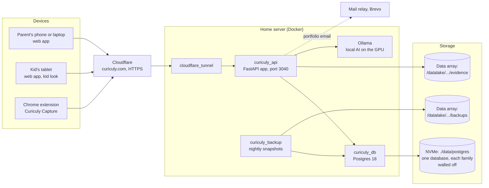

# How Curiculy works (plain language)

## The pieces
- **The web app** is one page: `index.html` with `static/js/app.js` and `static/css/tokens.css` + `app.css`. **A new React app** (`frontend/`) is taking over screen by screen at `/next`; its first screen is the kid's [My trail](../2-features/19-my-trail.md).
  - It works on phones, tablets and computers.
  - It switches to the **kid look** when a child signs in.
  - A small **service worker** (`sw.js`) keeps the app's files on the device so it opens offline. See [Offline](../2-features/16-offline-and-sync.md).
- **The server** (`curiculy_api`) is a Python **FastAPI** app in Docker. It answers every `/api/...` request, about 100 of them (see [API reference](../5-engineering/api-reference.md)), and serves the web app.
- **Data is kept in one Postgres database** (`curiculy_db`), with each family walled off from every other by the database itself (row-level security):
  - **shared tables:** sign-ins (parents and kids' PINs), invite keys, family codes, capture tokens and recent request keys; and a cache of book details looked up by ISBN
  - **family tables:** each family's kids, lessons, plans, attendance, notes, notifications and so on. Every row carries its family's id, and a request can only see and change its own family's rows.

  The app connects with a role that can't switch this off, and it refuses to start unless every family table is protected. See [Data model](../5-engineering/data-model.md).
- **Work samples** (photos and PDFs) are files on the big data array, one folder per family. Only paths are stored in the database.
- **AI** runs locally on the home server's GPU through **Ollama**, and only on the parent's side: reading PDF and handwritten lesson plans on the older catalog page. **No AI talks to children.** See [AI features](../2-features/17-ai-features.md).
- **Backups:** the `curiculy_backup` container dumps the database nightly, proves the dump restores, writes one file per family, mirrors new work samples, and keeps 14 days. See [Backups](../4-operations/backups-and-restore.md).
- **Public access:** Cloudflare handles HTTPS for **curiculy.com** and forwards traffic through a tunnel to the server's port 3040. The app records each visitor's real address for rate limits and logs.

## A request, start to finish (checking off a lesson)
1. Ada taps the check box on her tablet. The app sends `PATCH /api/assignments/42/status` with her sign-in token and a unique "idempotency key".
2. Cloudflare → tunnel → `curiculy_api`.
3. The server confirms the token, sees she's a child, and checks that lesson 42 is **hers**.
4. It opens a session for her family: Postgres now shows that session only her family's rows. It sets the status to completed, and saves.
5. The reply comes back. The app shows the celebration and fills in a star.
6. If the internet had dropped, the change would wait on the tablet and be sent once when it returns (see [Offline](../2-features/16-offline-and-sync.md)).

## Where things live (folders)
| Folder | What it is |
|---|---|
| `/home/objadv/curiculy` | **Production.** The running app's files, on the local branch `production`. Changes here reach families immediately, so don't edit it by hand. |
| `/home/objadv/curiculy-dev` | **Development copy** (a git worktree). All work happens here. |
| `/home/objadv/curiculy-ops` | The scheduled **log check** script and its reports |
| `/datalake/projects/curiculy/evidence` | Work-sample files |
| `/datalake/projects/curiculy/backups` | Nightly snapshots |
| GitHub `Object-Advanced/curiculy` | The code; pull requests; tests run on every push |

More detail: [Production and deploys](../4-operations/production.md), [Codebase map](../5-engineering/codebase-map.md).
