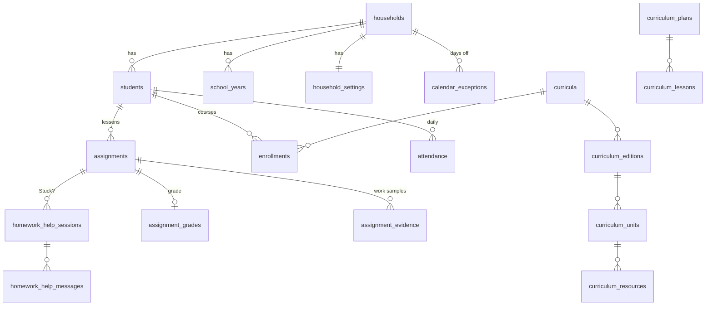

# Data model

Curiculy keeps data in **three kinds of SQLite file**, all in `./data` on the server's NVMe drive. Each file uses WAL mode with foreign keys on and a 5-second busy timeout.

## 1. `admin.db`: who can sign in (shared)
| Table | Holds |
|---|---|
| `users` | Parents (email, password hash, admin flag) and **kid sign-ins** (role `child`, `student_id`, PIN lockout counters). Each row points to its family by `tenant_uuid`. |
| `invite_keys` | Single-use registration keys |
| `family_codes` | One code per family, for kid sign-in |
| `capture_tokens` | Chrome extension credentials (revocable) |
| `idempotency_records` | Recent write keys, so retries apply once (kept 2 days) |

## 2. `catalog.db`: book cache (shared by all families)
| Table | Holds |
|---|---|
| `book_editions`, `works`, `authors`, `work_authors`, `publishers` | Book details looked up by ISBN (Open Library or Google Books) |
| `subject_taxonomies`, `reporting_categories` | Subject lists (defined but **nothing writes to them yet**) |

## 3. `tenant_<household id>.db`: one family's data (one file per family)

| Table | Holds |
|---|---|
| `households` | Name and **time zone** |
| `students` | Each child: name, grade, color |
| `school_years` | Name, start and end dates (the latest is "operational") |
| `household_settings` | School weekdays; colors for days off |
| `calendar_exceptions` | Days off (kind, title, dates, optional single child) |
| `assignments` | **Lessons:** child, title, `scheduled_date`, `completion_date`, `status`, `notes`, book, unit and resource links, `shared_group_uuid` |
| `assignment_grades`, `assignment_evidence` | A grade; work-sample file paths |
| `evidence_staging` | The unsorted inbox (captures not yet filed) |
| `attendance` | One row per child per day |
| `curricula`, `curriculum_editions`, `curriculum_units`, `curriculum_resources`, `curriculum_page_mappings` | The family's books and programs and their structure |
| `curriculum_plans`, `curriculum_lessons` | Lesson plans (Week/Day guides) and their lessons |
| `enrollments` | Child + book + school year ("course") |
| `homework_help_sessions`, `homework_help_messages` | Stuck? nudges |
| `parent_notifications` | The bell's messages |
| `curriculum_classifications` | Links books to subjects (rarely used) |
| `jurisdictions`, `compliance_packets` | **Placeholders, never used.** Planned to be dropped from the code (the tables stay) in Phase 5 |

## How the schema changes
- Brand-new tables come from SQLAlchemy `create_all` at startup.
- New columns on existing files come from **`app/schema_patches.py`**: ordered, repeat-safe `ALTER TABLE` patches. The old Alembic chain was removed in October 2026.
- **Planned:** stamp each file with `PRAGMA user_version` and apply patches lazily, so startup doesn't open every family's file (Phase 5).

## Known data gaps
- **`assignments.completion_date` isn't set when a lesson is checked off** (only `status` changes). Home and Portfolios use status instead, but the Sticker Journal needs the date. Fix in Phase 5 or sooner.
- **Lessons aren't tied to a school year,** so reports use date ranges.
- **The subject comes from a taxonomy nothing fills in,** which is why lessons say "Subject: Unfiled". Take it from the book instead.
