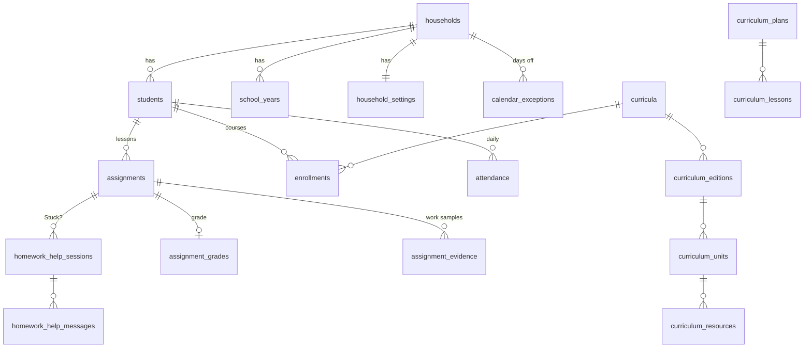

# Data model

Curiculy keeps its data in **one Postgres database** (`curiculy`, Postgres 18), stored on the server's NVMe drive (`./data/postgres`). The database itself walls every family off from every other with **row-level security**. Until October 2026 each family had its own SQLite file; see the [decision record](../6-planning/decision-records/data-tier.md) for why that changed.

## How families are kept apart
- **Every family table has `tenant_id`**: the family's id, the same as `users.tenant_uuid`. A demo visitor's family is `demo-…`.
- **Each family table has a policy:** a connection sees and writes only rows whose `tenant_id` equals `curiculy_current_tenant()`. That function reads the `app.tenant_id` setting of the current transaction, and returns NULL when none is set.
- **Row-level security is forced** on every family table, so even the tables' owner is held to it, unless it's a role allowed to bypass it (below).
- **A request's session (`TenantSession` in `app/db.py`) sets `app.tenant_id` at the start of every transaction,** with `set_config(..., true)`. That's the same as `SET LOCAL`: it ends with the transaction, so it can never carry over to the next request on a pooled connection.
- **A session that never sets it** (the sign-in and book-cache sessions) sees no family rows at all, and can't insert any. `tenant_id` defaults to `curiculy_current_tenant()` and is `NOT NULL`.
- **References between family tables also match on `tenant_id`.** Each foreign key has a twin on `(tenant_id, column)` → `(tenant_id, id)`, so a row can't point at another family's row.

### Two roles
| Role | Used by | Can |
|---|---|---|
| `curiculy_app` | the API (`DATABASE_URL`) | read and write rows only. **Owns nothing, can't bypass row-level security**, isn't a superuser. |
| `curiculy_owner` | migrations, startup upkeep, backups (`DATABASE_OWNER_URL`) | owns the tables; bypasses row-level security (backups must see every family). Never used to answer a request. |

Both are created on the database container's first start by `docker/postgres/10-curiculy-roles.sh`.

### The safety check
**`app/db_safety.py` refuses to start the app** (and fails the tests) unless:
1. the app's role isn't a superuser, can't bypass row-level security, and owns no tables
2. every table is either a family table (has `tenant_id`, row-level security on **and forced**, a policy), or on the short list of shared tables
3. every reference between family tables also matches on `tenant_id`
4. there are no views and no `SECURITY DEFINER` functions (both could skip the policies)

`tests/test_database.py` proves each rule against the live database. `tests/test_cross_family_probe.py` calls every API route as one family, using another family's ids.

## Shared tables (no `tenant_id`, no policy)
### Sign-ins (`AdminBase`)
| Table | Holds |
|---|---|
| `users` | Parents (email, password hash, admin flag) and **kid sign-ins** (role `child`, `student_id`, PIN lockout counters). Each row names its family by `tenant_uuid`. |
| `invite_keys` | Single-use registration keys |
| `family_codes` | One code per family, for kid sign-in |
| `capture_tokens` | Chrome extension credentials (revocable) |
| `idempotency_records` | Recent write keys, so retries apply once (kept 2 days) |

### Book cache (`CatalogBase`, shared by all families)
| Table | Holds |
|---|---|
| `book_editions`, `works`, `authors`, `work_authors`, `publishers` | Book details looked up by ISBN (Open Library or Google Books) |
| `subject_taxonomies`, `reporting_categories` | Subject lists (defined but **nothing writes to them yet**) |

## Family tables (`TenantBase`: `tenant_id`, row-level security)

| Table | Holds |
|---|---|
| `households` | The family: name and **time zone**. **Exactly one per family** (unique `tenant_id`). |
| `students` | Each child: name, grade, color |
| `school_years` | Name, start and end dates (the latest is "operational") |
| `household_settings` | School weekdays; colors for days off |
| `calendar_exceptions` | Days off (kind, title, dates, optional single child) |
| `assignments` | **Lessons:** child, title, `scheduled_date`, `completion_date`, `status`, `notes`, book, unit and resource links, `shared_group_uuid` |
| `assignment_grades`, `assignment_evidence` | A grade; work-sample file paths |
| `evidence_staging` | The unsorted inbox (captures not yet filed) |
| `attendance` | One row per child per day |
| `curricula`, `curriculum_editions`, `curriculum_units`, `curriculum_resources`, `curriculum_page_mappings` | The family's books and programs and their structure |
| `curriculum_plans`, `curriculum_lessons` | Lesson plans (Week/Day guides) and their lessons |
| `enrollments` | Child + book + school year ("course") |
| `homework_help_sessions`, `homework_help_messages` | Stuck? nudges |
| `parent_notifications` | The bell's messages |
| `curriculum_classifications` | Links books to subjects (rarely used) |

The placeholder tables `jurisdictions` and `compliance_packets` were removed in the move to Postgres; state requirements get a real design in the [Product spine](../6-planning/product-spine.md).

## Planned redesign (core loop, 2026-10-11)
There are no real users yet, so the tables for curricula, lesson plans, enrollments, work samples and subjects are being **redesigned cleanly**, not patched. The two curriculum structures become one Curriculum + Materials + Guide model, plus Reading books, Courses, Requirement packs and Tasks. See [Product spine: data model changes](../6-planning/product-spine.md#data-model-changes).

## How the schema changes
- **Alembic migrations** in `migrations/versions/`, run as the owner role at startup (`python -m app.db_startup`, called by `entrypoint.sh`). Each migration runs in one transaction: it applies fully or not at all.
- **A new family table also needs, in its migration,** `tenancy.protect_family_table("<table>")` and `tenancy.add_family_reference(...)` for each reference to another family table (`migrations/tenancy.py`). The safety check refuses to start if either is missing.
- **To write one:** change the models, run `alembic revision --autogenerate -m "…"`, read what it wrote, then add the tenancy steps. `tests/test_database.py` fails if the migrations and models disagree.
- The baseline is `0001` (October 2026), the first Postgres schema.

## Known data gaps
- **Lessons aren't tied to a school year,** so reports use date ranges.
- **The subject comes from a taxonomy nothing fills in,** which is why lessons say "Subject: Unfiled". The spine gives subjects a real home.
- **Some lesson-to-book links are plain numbers without a foreign key** (`assignments.curriculum_id`, `curriculum_resource_id`, `curriculum_unit_id`, `enrollments.curriculum_id`), left over from when books might live in another file. Row-level security still hides other families' rows; the spine's redesign adds real references.
