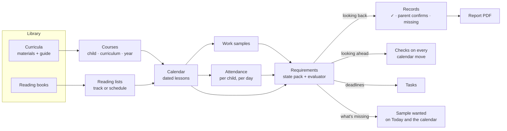

# Product spine

How Curiculy's pieces fit together: the words, the core loop, and what each feature is *for*. Agreed with the owner on **2026-10-11**. **Nothing on this page is built yet** unless it says "today". Feature pages in `2-features/` describe what exists now; this page is where they're heading.

## Why this page exists
Curiculy had many good parts that didn't obviously fit: a pacing engine, lesson-plan imports, evidence capture, portfolios, attendance, a kid trail. The roadmap was spending its time on the edges (the React port, kid extras), while the things that make Curiculy different were marked "out of scope" or "Later". This page puts the core first and gives every part a job.

## The four pillars
1. **A cheaper hub for families who mix programs.** Families who don't use one all-in-one curriculum (BJU, Abeka, Christian Light). Free options like Easy Peasy exist, but they're their own curriculum. State homeschool funding is growing, and more families are building their own mix.
2. **Community guides.** The hard part of planning is entering each program's lessons. The first family enters a program once, and every family after them plans a year in minutes.
3. **State requirements, met and not just explained.** Each state's homeschool law (see [HSLDA's state map](https://hslda.org/legal)) becomes a checklist Curiculy can actually fill from the family's records.
4. **Records that build themselves, FSM-style.** Like a technician attaching photos to a job in field-service software, parents attach work to lessons as they go. Reports show what's there, what's missing, and print as PDFs.

Curiculy still **guides and doesn't teach** ([decision, 2026-10-10](decisions.md)). The parent owns the curriculum; the app is the plan, the nudge and the record.

## The core loop

**One rules engine, two directions.** Looking back, it fills Records ("so far"). Looking ahead, it checks the calendar ("if you make this move"). Because it knows what's missing, it marks upcoming lessons **"sample wanted"**, so parents photograph what's needed instead of everything.

## Words
Parents see: **Today · Calendar · Library (Curricula · Reading books) · Records · Tasks.**

| Word | Means | Example |
|---|---|---|
| **Library** | The family's shelf, in **two separate sections** with separate Add flows | |
| **Curriculum** | A program you teach from: its materials plus its guide. Has a subject. One meaning only. | BJU Math 5 (4th ed.); Saxon 5/4; a single Spectrum workbook |
| **Material** | One physical item in a curriculum; each can have an ISBN | Student text, worktext, teacher's edition, answer key, test pack |
| **Guide** | A curriculum's lesson list, each lesson pointing at pages in its materials. **What the community shares.** | "Lesson 42: Text pp. 212–215, Worktext p. 88" |
| **Reading book** | A book to *read*. It has chapters, not a guide. | The Lord of the Rings, a biography, a read-aloud |
| **Reading list** | One child's reading books, with started and finished dates and the subject each counts toward | |
| **Course** | One child + one curriculum + one school year, with weekdays and a start date. A child's courses *are* "their curriculum this year." | Ada · Math · BJU Math 5 · 2026–27 |
| **Lesson** | One dated item on the calendar: from a course, a scheduled reading book, or a one-off | |
| **Work sample** | A photo, scan, PDF or screenshot on a lesson, or on child + subject + date with no lesson | A worksheet; a field-trip photo |
| **Attendance** | Whether each child did school that day (and, in hours mode, for how long) | |
| **Requirement** | One rule from a **state pack**, adjusted for the family's evaluator | "180 days"; "samples of work" |
| **Records** | The dashboard that checks the requirements, and the reports it prints | |
| **Task** | A **parent** to-do with a due date, mostly made by the state pack | "Affidavit due Aug 1"; "Book your evaluator" |

**Words we stop using:** "Curriculum" for a single book or for a child's whole year; "Lesson plan" (it's a **guide**); "Auto-schedule" and "Apply" (both become **Schedule**); "Enrollment" (it's a **course**).

## Library: two shelves, two setups
A workbook-and-textbook program and a novel are different things, and they get different setups.

### Add a curriculum
Heavier, about once per subject per year.
1. **Find it:** search by name ("BJU Math 5") or scan the ISBN of any one of its materials.
2. **Confirm the edition** and tick the materials you own.
3. **Pick a guide:**
   - the community's ("used by 14 families")
   - import one: CSV, PDF, or a photo of the table of contents or a paper plan
   - build it by hand
   - or "just split the pages" (today's pacing engine)
4. **Who and when:** child or children, start date, days per week. This makes a **course** and its dated lessons. The subject is filled in.
5. **Optional:** share your guide with other families.

### Add a reading book
Light, about 30 seconds, done often.
1. **Find it:** scan or search by ISBN or title.
2. **Who's reading it:** one or more kids, or a family read-aloud.
3. **How:**
   - **Just track it** (the default): it's on their reading list; mark it started and finished
   - **Schedule it:** chapters or pages a day, or finish by a date. This makes daily "Read ch. 3–4" lessons.
4. **Counts toward:** Reading by default; a biography can count toward History.

### Where the shelves meet
- **A curriculum's lesson can name a reading book** ("Read ch. 1–3 of Charlotte's Web"). The book is linked and goes on the child's reading list automatically.
- **Which flow a scan starts:** a known curriculum ISBN offers "This is part of BJU Math 5. Set up the curriculum?" Anything else defaults to a reading book, with a "this is a textbook or workbook" switch.
- **The Library page has two buttons:** **Add curriculum** · **Add reading book**.
- **Kid side:** lessons point to materials ("Get your BJU Math 5 Worktext, p. 88"), and a **My books** shelf shows their reading list.

## Attendance: per child, one tap
Today: one record per child per day (present, absent, sick, vacation), marked with Yes/No radios in every calendar cell. Nothing is suggested, and there's no "everyone present".
- **A "School today?" card on Today** has one row per child, pre-filled from activity. A child who started or finished a lesson today shows **Present (suggested)**.
  - One tap on **Looks right** confirms everyone.
  - Tap a child to change just them: Sick, Absent, or Field trip (counts as present).
- **Weekly sweep:** "3 days this week aren't marked" opens the same card for each day, pre-filled.
- **Nothing is recorded without a parent's tap.** Whether a day with finished work may count with no tap is an [open question](#open-questions).
- **Days off fill themselves in.** A lesson done on a non-school day asks "Count Saturday as a school day for Ada?"
- **Per child, always:** siblings can differ. On the calendar, each day shows one small dot per child instead of radios.
- **A sick day connects to the calendar:** marking a child Sick offers "Move Ada's lessons from today?"
- **Counts on Today and Records:** "Ada: 92 of 180 days; on track for 181 by June 5." In **hours mode**, a present day adds up its lesson minutes (estimated from the guide or course, and editable).

## Calendar: move things, stay within the guidelines
Today: Day, Week and Month views, plus **Recalibrate**, which pushes overdue lessons forward. There's no single-lesson move, no preview, and no checks.

### Guidelines the calendar keeps
- **The family's own:**
  - school days, days off, and the school year's start and end
  - each course's days per week
  - **lesson order within a course**: lesson 43 never lands before 42
  - a daily load per child (lessons or minutes), which is today's "rigorous" flag made into a setting
- **The state's,** from the family's reviewed pack: days or hours planned vs required, required subjects still scheduled, samples per term, deadlines.

### Moves (every one previews before anything changes)
- **One lesson:** drag on a computer, or **Move to…** on a phone, with suggested days. Course lessons are a sequence, so it asks: "Push the rest of Saxon back a day?" or "Just this one" (swapping if needed to keep the order).
- **A day:** "Ada is sick Tuesday" or "We're off Friday". Each affected course moves forward from that day.
- **A course:** change its days per week, pause it (a co-op term, summer), or set a finish-by date. It re-paces.
- **Catch up** (today's Recalibrate): reached from an overdue banner on Today, now with a preview, and for several children at once.

### Every preview says what the move does, with fixes to choose from
- "Saxon now finishes June 12, after your school year ends June 5." **Add Saturdays in May** · **Double up 7 lessons** · **Extend the year**
- "Ada: 178 of 180 school days planned." **Add 2 days**
- "Tuesday becomes 6 lessons (your limit is 5)."
- "Q2 science still needs 1 sample; 2 science lessons are left this quarter."

**Warnings, not blocks:** the parent owns the plan. The one hard rule is that finished lessons never move.

**Views:** an agenda list on phones; Week and Month on computers; **All Students** shows every lesson, with a filter chip per child.

## Work samples: adding them should take seconds
Parents may add work every day, so this has to be nearly free. **Capture is parent-only for launch:** most kids don't have a device with a camera.

### For launch
1. **Add work, right on the lesson.** The lesson sheet has one big **Add work** button:
   - **Take photo** opens the camera directly
   - **Choose files** takes several photos or a PDF at once
   - on computers, **paste** a screenshot, or **drag files** onto the sheet, or straight onto the lesson's card on the calendar (like dropping a photo on a field-service job)
   
   There are no fields to fill in: the child, date, subject and lesson are already known.
2. **Asked at check-off, only when needed.** Checking off a lesson marked "sample wanted" offers **Snap the work?** One tap opens the camera, and Skip is fine. A setting chooses when to ask: when a sample is wanted (default), every lesson, or never.
3. **Snap the stack.** At the end of the day, open **Today's work**. The camera stays open while you photograph each worksheet in turn. Under each photo, today's lessons appear as chips, best guess first (by child, subject and time). Tap a chip to file it. Anything left over goes to the inbox.
4. **Several pages, one sample.** A three-page test is one work sample, kept and printed together. Phone scanner apps (Notes or Files "Scan documents" on iPhone, Google Drive on Android) already straighten pages into PDFs, and Curiculy takes those as they are.
5. **One photo, every sibling.** On a shared lesson, one photo files onto each child's copy. The upload already accepts an "apply to group" flag; today it ignores it.
6. **An optional line about it:** a caption or a score ("18/20, did it alone"). A score can fill in the lesson's grade.
7. **Uploads never make you wait.** Photos shrink on the phone before sending, upload in the background with a small progress chip, and wait for a connection when offline. iPhone (HEIC) photos are converted.
8. **Mistakes take one tap to fix:** **Move to another lesson** and **Remove** on every sample.
9. **See it build up:** Records shows a gallery per child, subject and term, and "sample wanted" disappears once a sample covers it.

### After launch
- **A private upload email address** per family: forward photos to it, or point a home printer's scan-to-email at it. Items land in the inbox with suggestions.
- **Share to Curiculy** from the phone's Photos app. This works for installed web apps on Android; iPhone would need a native app.
- **Read the page number** off a worksheet ("Worktext p. 88") and match it to the lesson that lists those pages, using the vision AI that reads paper plans today.
- **Edge detection and auto-crop** in the in-app camera.

### The Chrome extension
It stays and nothing is deleted. It becomes a **parent tool**: screenshot an online program's results or parent dashboard (IXL, Khan Academy, Teaching Textbooks) into the inbox. It's documented as an optional extra with setup steps.

**Parked:** prompting a *kid* to save a score page. That's only realistic for a curated list of sites (matched by web address plus "score" or "%" text on the page), and it needs per-child sign-in. A short site list would also fix the extension's all-sites permission for Chrome Web Store review.

### The inbox
Anything not filed straight onto a lesson lands in the inbox with a **suggested child, subject and lesson**, from the time and what was due or just finished. One tap files it. The inbox is a safety net, not the main path.

## Requirements, Records and Tasks
- **State packs are data:** versioned and dated ("reviewed 2027-05"), written from the statute and the state's own guidance, linking to HSLDA rather than copying it, with a "not legal advice" note.
- **Each pack is built from a few rule types**, confirmed only through review: deadline; subjects by grade band; days or hours; a log kept as you go; reading list; samples per subject per term; tests by grade; evaluator letter; periodic report; and **parent confirms**, the honest fallback.
- **The family adjusts the pack for their evaluator.** Laws often say "samples of work", and the evaluator decides how many.
- **Records** shows each child's checklist in three states:
  - **✓ Shown by your records:** worked out from the data
  - **Parent confirms:** a checklist item with an optional upload
  - **Missing:** each line goes straight to the fix ("Q2 science: 1 of 2 samples. Attach to a lesson")
- **Report templates per state come first;** a generic custom-report designer comes later. Today's portfolio presets and WeasyPrint PDFs are the output layer.
- **Tasks** are parent to-dos with due dates, made by the pack ("Affidavit due Aug 1", "Book your evaluator", "Certification due June 30") or added by hand.

### No square pegs
When a requirement asks for something Curiculy doesn't have, we don't squeeze it into the nearest field. We stop, review it with the owner, and decide: a correct mapping, a new feature, or "handled outside Curiculy". Curiculy never shows a ✓ it can't actually check. The process and each state's worksheet are in [State requirements](state-requirements/README.md). **Pennsylvania is first** ([worksheet](state-requirements/pennsylvania.md)); New York is likely next (its yearly plan and quarterly reports can be generated from courses).

## Community guides
- **Sharing costs no extra effort:** one toggle when saving a guide the family had to enter anyway.
- **Keyed to ISBN and edition** in the shared catalog: "3 families have a guide for this book. Use it?"
- **The easiest way in is a photo of the table of contents** (chapters and pages), read by the existing vision and PDF pipeline, with a review screen.
- **We seed it ourselves** with the most-used mix-and-match programs, including single BJU and Abeka subjects that families buy one at a time.
- **Trust:** edition-specific, "used by N families", forks ("adapted for 4 days a week"), report an error.
- **Copyright and privacy:** share structure only (lesson number, title, pages, type). Never share teacher's-guide text, private notes or anything about a child. Get a lawyer's read before the public launch.
- **Reading books share chapter lists at the work level,** so they hold across editions.

## Data model changes
**There are no real users yet** (invites haven't gone out), so the model can be redesigned cleanly, with no backfills. Final table names are settled when each piece is built.

| Today | Becomes |
|---|---|
| `curricula` + `curriculum_editions` | **Curriculum** (title, publisher, edition, subject, grade) |
| `curriculum_resources` | **Material** (kind; ISBN linked to `catalog.db` `book_editions`) |
| `curriculum_units`, `curriculum_page_mappings`, `curriculum_plans`, `curriculum_lessons` (two unconnected structures) | **Guide** + **guide lessons** (number, title, type, pages per material, minutes, optional reading-book link) |
| none | **Reading book** (linked to a catalog work) and **reading-list entry** (child, status, started and finished dates, counts toward, optional schedule) |
| `enrollments` | **Course** (child, curriculum, guide, school year, weekdays, start date, pauses) |
| `assignments` | **Lesson**: adds its course, its place in the sequence, subject, minutes, and an optional reading-book link |
| `attendance` | adds how it was set (suggested or confirmed) and minutes |
| `school_years` | adds terms (quarters) |
| `assignment_evidence`, `evidence_staging` | **Work sample** (child, subject, date, optional lesson, pages, caption); inbox items carry suggestions |
| `subject_taxonomies`, `reporting_categories`, `curriculum_classifications` (empty or unused) | one fixed **subject** list; each state pack maps its subjects onto it |
| `jurisdictions`, `compliance_packets` (placeholders) | **Requirement packs** (shared, versioned), the family's chosen pack with evaluator adjustments, and **Tasks** |
| `household_settings` | adds a daily load limit and days-or-hours mode |
| `students` | adds a birth date (Pennsylvania's affidavit asks for ages) |
| shared `catalog.db` | adds community guides, curriculum programs (their materials' ISBNs) and chapter lists |

**Decide the data tier first.** With no users, this is the cheapest moment to switch to Postgres if it wins, and shared guides need a shared database. See [Decisions](decisions.md).

## Order of work
| When | Work |
|---|---|
| Oct–Dec 2026 | Data-tier decision; then the backend spine: subjects → Curriculum, Materials and Guide → Reading books and reading lists → Course → minutes and terms → attendance suggestions → move engine with previews and the plan checker → requirement packs and Tasks → the **Pennsylvania pack** (after its worksheet is reviewed) → the Records API → inbox suggestions |
| Jan–Mar 2027 | The loop's screens, built **directly in React**: Today ("School today?", Tasks, overdue banner, "sample wanted"), Calendar (drag and Move to…, previews, warnings), Library (two Add flows), lesson sheet (Add work), Records, kid's My books. Community guides v1, seeded. Pennsylvania report template. |
| Mar–May 2027 | Second wave of states, starting with New York; extension docs; launch work (Phase 8). Feature freeze mid-May. |
| Jun 2027 | Launch with an honest "N states supported" claim and a seeded guide catalog |

## Parked until after launch
Cheers from home and more kid extras; kids capturing their own work; the kid score-snap extension idea; a generic custom-report designer; the upload email address; Share to Curiculy; page-number matching.

## Open questions
- **Attendance:** may a day with finished work count automatically, with no parent tap?
- **Pricing:** a natural split is **free** (planner and community guides, to grow the catalog and compete with free options) and **paid** (requirements, Records and work-sample storage). Check competitors' prices before setting numbers.
- **State funding (ESAs):** can Curiculy be an eligible expense, and are ESA record rules a kind of pack?
- **Pennsylvania:** see the [worksheet's open questions](state-requirements/pennsylvania.md#open-questions-for-review).
