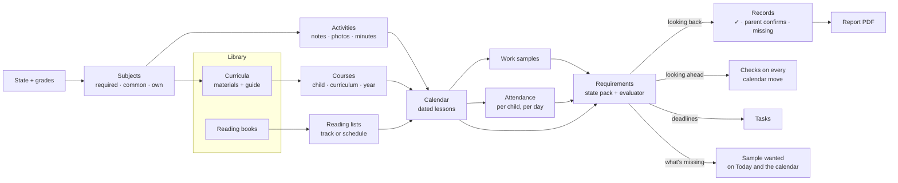

# Product spine

How Curiculy's pieces fit together: the words, the core loop, and what each feature is *for*. Agreed with the owner on **2026-10-11**. **Nothing on this page is built yet** unless it says "today". Feature pages in `2-features/` describe what exists now; this page is where they're heading.

## Why this page exists
Curiculy had many good parts that didn't obviously fit: a pacing engine, lesson-plan imports, evidence capture, portfolios, attendance, a kid trail. The roadmap was spending its time on the edges (the React port, kid extras), while the things that make Curiculy different were marked "out of scope" or "Later". This page puts the core first and gives every part a job.

## The four pillars
1. **A cheaper hub for families who mix programs.** Families who don't use one all-in-one curriculum (BJU, Abeka, Christian Light). Free options like Easy Peasy exist, but they're their own curriculum. State homeschool funding is growing, and more families are building their own mix.
2. **Community guides.** The hard part of planning is entering each program's lessons. The first family enters a program once, and every family after them plans a year in minutes.
3. **State requirements, met and not just explained.** Each state's homeschool law (see [HSLDA's state map](https://hslda.org/legal)) becomes a checklist Curiculy can actually fill from the family's records.
4. **Records that build themselves, FSM-style.** Like a technician attaching photos to a job in field-service software, parents attach work to lessons as they go. Reports show what's there, what's missing, and print as PDFs.

Curiculy still **guides and doesn't teach** ([decision, 2026-10-10](decisions.md)). The parent owns the curriculum; the app is the plan, the nudge and the record.

## Like tax software for homeschooling
The two main selling points:
- **Scheduling several curricula is easy.** There's some setup at the start; after that, the days run themselves.
- **You follow your state's rules and end the year with the right portfolio.**

The model is tax software: it asks plain questions, explains each rule at the moment it matters, keeps a "what's left" checklist, and at the end hands over a finished, checked packet.

| When | What Curiculy does |
|---|---|
| **Sign-up (year setup)** | A guided interview: your state → your kids and their grades → the subjects your state requires for each grade → a one-line objective per subject → a curriculum (or activities) for each subject → schedule it |
| **Through the year** | Today, the calendar and Add work. Records keeps a "what's left" checklist: days, subjects, samples, deadlines. |
| **Each July 1** | "Set up 2027–28": confirm each child's grade, your state, and next year's subjects and curricula. Tasks for anything due (Pennsylvania: the affidavit by August 1). |
| **Year end** | "Build your portfolio": start from your state's preset, adjust it for your evaluator, fix any flags, then print or send |

## The core loop

**One rules engine, two directions.** Looking back, it fills Records ("so far"). Looking ahead, it checks the calendar ("if you make this move"). Because it knows what's missing, it marks upcoming lessons **"sample wanted"**, so parents photograph what's needed instead of everything.

## Words
Parents see: **Today · Calendar · Library (Curricula · Reading books) · Records · Tasks.**

| Word | Means | Example |
|---|---|---|
| **Library** | The family's shelf, in **two separate sections** with separate Add flows | |
| **Curriculum** | A program you teach from: its materials plus its guide. Fills one or more subject slots. One meaning only. | BJU Math 5 (4th ed.); Saxon 5/4; a single Spectrum workbook |
| **Material** | One physical item in a curriculum; each can have an ISBN | Student text, worktext, teacher's edition, answer key, test pack |
| **Guide** | A curriculum's lesson list, each lesson pointing at pages in its materials. **What the community shares.** | "Lesson 42: Text pp. 212–215, Worktext p. 88" |
| **Reading book** | A book to *read*. It has chapters, not a guide. | The Lord of the Rings, a biography, a read-aloud |
| **Reading list** | One child's reading books, with started and finished dates and the subject each counts toward | |
| **Course** | One child + one curriculum + one school year, with weekdays and a start date. A child's courses *are* "their curriculum this year." | Ada · Math · BJU Math 5 · 2026–27 |
| **Subject** | What a child studies, of three kinds: **required** by the state for the child's grade, a **common** preset, or the family's **own**. Curricula and activities belong to subjects. | Math; Safety education; Bible |
| **Objective** | One line per subject, per child, per year, written in setup. Together they make the state's "objectives by subject" outline. | "Finish BJU Math 5: fractions, decimals, early geometry" |
| **Lesson** | One dated item on the calendar: from a course, a scheduled reading book, or a one-off. **Replaces "assignment" everywhere, including the code and API** (cheap now, with no users). | |
| **Activity** | Something logged for a subject without a curriculum: a note, photos, a video or a link, and minutes. Counts like a lesson. | "5K race, PE, 40 min"; "Piano recital" |
| **Work sample** | A photo, scan, PDF or screenshot on a lesson, or on child + subject + date with no lesson | A worksheet; a field-trip photo |
| **Attendance** | Whether each child did school that day (and, in hours mode, for how long) | |
| **Requirement** | One rule from a **state pack**, adjusted for the family's evaluator | "180 days"; "samples of work" |
| **Records** | The dashboard that checks the requirements, and the reports it prints | |
| **Task** | A **parent** to-do with a due date, mostly made by the state pack | "Affidavit due Aug 1"; "Book your evaluator" |

**Words we stop using:** "Assignment" (it's a **lesson**); "Curriculum" for a single book or for a child's whole year; "Lesson plan" (it's a **guide**); "Auto-schedule" and "Apply" (both become **Schedule**); "Enrollment" (it's a **course**).

## Subjects: what everything hangs on
- **The state is picked at sign-up** and can be changed in Settings when a family moves. A move takes effect from a date, so each part of the year is checked against the right state.
- **Each child's grade** is picked from a fixed list at setup and re-confirmed every **July 1**.
- **The state's required subjects for that grade appear on the dashboard as slots**, per child: "Math: add a curriculum", "Safety education: add a curriculum or log activities". Families can add **common subjects** (Bible, a foreign language, typing, logic, life skills) or **their own**.
- **A slot is filled by a curriculum, activities, or both.** One curriculum can cover several subjects, or several parts of one (an English program covering reading, writing and spelling).
- **Each subject says what it counts toward.** Presets map automatically. For a custom subject, the parent picks: "Language Arts" counts toward Pennsylvania's English, for example, or it counts toward nothing. The choice is the parent's and is shown plainly (no square pegs).
- **Objectives are written in setup:** one line per subject, starting from a suggestion the parent edits. Together they print as the state's "objectives by subject" outline.

## Library: two shelves, two setups
A workbook-and-textbook program and a novel are different things, and they get different setups.

### Add a curriculum
Heavier, about once per subject per year.
1. **Find it:** search by name ("BJU Math 5") or scan the ISBN of any one of its materials.
2. **Confirm the edition** and tick the materials you own.
3. **Pick a guide:**
   - the community's ("used by 14 families")
   - import one: CSV, PDF, or a photo of the table of contents or a paper plan
   - build it by hand
   - or "just split the pages" (today's pacing engine)
4. **Who and when:** child or children, start date, days per week. This makes a **course** and its dated lessons. The subject is filled in.
5. **Optional:** share your guide with other families.

### Add a reading book
Light, about 30 seconds, done often.
1. **Find it:** scan or search by ISBN or title.
2. **Who's reading it:** one or more kids, or a family read-aloud.
3. **How:**
   - **Just track it** (the default): it's on their reading list; mark it started and finished
   - **Schedule it:** chapters or pages a day, or finish by a date. This makes daily "Read ch. 3–4" lessons.
4. **Counts toward:** Reading by default; a biography can count toward History.

### Where the shelves meet
- **A curriculum's lesson can name a reading book** ("Read ch. 1–3 of Charlotte's Web"). The book is linked and goes on the child's reading list automatically.
- **Which flow a scan starts:** a known curriculum ISBN offers "This is part of BJU Math 5. Set up the curriculum?" Anything else defaults to a reading book, with a "this is a textbook or workbook" switch.
- **The Library page has two buttons:** **Add curriculum** · **Add reading book**.
- **Kid side:** lessons point to materials ("Get your BJU Math 5 Worktext, p. 88"), and a **My books** shelf shows their reading list.

## Activities: subjects without a curriculum
Many required subjects (PE, music, art, health, safety education) rarely have a curriculum. They're recorded as **activities**.
- **Log an activity** from ＋ or from the subject's slot: which children, which subjects, the date, minutes, a note, and photos, a video or a link. Examples: "5K race, PE, 40 min" with a photo at the finish line; "Piano practice, Music, 20 min"; a drawing for Art.
- **Repeating activities** ("Piano Mon/Wed/Fri, 20 min") appear on the calendar like light lessons, and one tap logs them.
- **Activities count like lessons:** toward subjects, days and hours. Their photos and videos are work samples in the portfolio.
- **Videos:** short clips upload with a size cap, or paste a link (an unlisted YouTube video, a Google Drive file). Work samples already have a link field.
- **Basic first:** notes, attachments and minutes. More only as real needs show up.

## Attendance: per child, one tap
Today: one record per child per day (present, absent, sick, vacation), marked with Yes/No radios in every calendar cell. Nothing is suggested, and there's no "everyone present".
- **A "School today?" card on Today** has one row per child, pre-filled from activity. A child who started or finished a lesson today shows **Present (suggested)**.
  - One tap on **Looks right** confirms everyone.
  - Tap a child to change just them: Sick, Absent, or Field trip (counts as present).
- **Weekly sweep:** "3 days this week aren't marked" opens the same card for each day, pre-filled.
- **Nothing is recorded without a parent's tap.** Whether a day with finished work may count with no tap is an [open question](#open-questions).
- **Days off fill themselves in.** A lesson done on a non-school day asks "Count Saturday as a school day for Ada?"
- **Per child, always:** siblings can differ. On the calendar, each day shows one small dot per child instead of radios.
- **A sick day connects to the calendar:** marking a child Sick offers "Move Ada's lessons from today?"
- **Counts on Today and Records:** "Ada: 92 of 180 days; on track for 181 by June 5." In **hours mode**, a present day adds up its lesson minutes (estimated from the guide or course, and editable).

## Lesson minutes
States that count hours need minutes. Kept simple:
- **A default per course,** asked once at setup ("About how long is a math lesson? 45 min"). Once a shared guide has data, it suggests one ("Families say about 40 min").
- **One tap at check-off:** time chips pre-filled with the default (30 · 45 · 60 · other). Also offered when adding work.
- **From the kid's trail:** when a child taps Start and later Done, the time in between is suggested (capped, and editable).
- **Only asked in hours mode.** Families counting days aren't asked.
- **The community learns:** real minutes feed back into the shared guide's estimate.

## Calendar: move things, stay within the guidelines
Today: Day, Week and Month views, plus **Recalibrate**, which pushes overdue lessons forward. There's no single-lesson move, no preview, and no checks.

### Guidelines the calendar keeps
- **The family's own:**
  - school days, days off, and the school year's start and end
  - each course's days per week
  - **lesson order within a course**: lesson 43 never lands before 42
  - a daily load per child (lessons or minutes), which is today's "rigorous" flag made into a setting
- **The state's,** from the family's reviewed pack: days or hours planned vs required, required subjects still scheduled, samples per term, deadlines.

### Moves (every one previews before anything changes)
- **One lesson:** drag on a computer, or **Move to…** on a phone, with suggested days. Course lessons are a sequence, so it asks: "Push the rest of Saxon back a day?" or "Just this one" (swapping if needed to keep the order).
- **A day:** "Ada is sick Tuesday" or "We're off Friday". Each affected course moves forward from that day.
- **A course:** change its days per week, pause it (a co-op term, summer), or set a finish-by date. It re-paces.
- **Catch up** (today's Recalibrate): reached from an overdue banner on Today, now with a preview, and for several children at once.

### Every preview says what the move does, with fixes to choose from
- "Saxon now finishes June 12, after your school year ends June 5." **Add Saturdays in May** · **Double up 7 lessons** · **Extend the year**
- "Ada: 178 of 180 school days planned." **Add 2 days**
- "Tuesday becomes 6 lessons (your limit is 5)."
- "Q2 science still needs 1 sample; 2 science lessons are left this quarter."

**Warnings, not blocks:** the parent owns the plan. The one hard rule is that finished lessons never move.

### A finished lesson sits on the day it was done
Lessons move (sick days, days off, catching up), so the record follows the calendar: **a finished lesson's completion date is the calendar day it sits on.**
- **Checked off on its own day:** done, dated that day.
- **Checked off late** (it's Thursday; the lesson is on Tuesday): one question, "Done on Tuesday, or today?" If today, the lesson moves to today, and nothing after it moves.
- **Done early** (tomorrow's lesson, today): it moves to today.
- **The portfolio's log reads straight off the calendar,** so it's right by construction. This answers Pennsylvania's "log made at the time of instruction".

**Views:** an agenda list on phones; Week and Month on computers; **All Students** shows every lesson, with a filter chip per child.

## Work samples: adding them should take seconds
Parents may add work every day, so this has to be nearly free. **Capture is parent-only for launch:** most kids don't have a device with a camera.

### For launch
1. **Add work, right on the lesson.** The lesson sheet has one big **Add work** button:
   - **Take photo** opens the camera directly
   - **Choose files** takes several photos or a PDF at once
   - on computers, **paste** a screenshot, or **drag files** onto the sheet, or straight onto the lesson's card on the calendar (like dropping a photo on a field-service job)
   
   There are no fields to fill in: the child, date, subject and lesson are already known.
2. **Asked at check-off, only when needed.** Checking off a lesson marked "sample wanted" offers **Snap the work?** One tap opens the camera, and Skip is fine. A setting chooses when to ask: when a sample is wanted (default), every lesson, or never.
3. **Snap the stack.** At the end of the day, open **Today's work**. The camera stays open while you photograph each worksheet in turn. Under each photo, today's lessons appear as chips, best guess first (by child, subject and time). Tap a chip to file it. Anything left over goes to the inbox.
4. **Several pages, one sample.** A three-page test is one work sample, kept and printed together. Phone scanner apps (Notes or Files "Scan documents" on iPhone, Google Drive on Android) already straighten pages into PDFs, and Curiculy takes those as they are.
5. **One photo, every sibling.** On a shared lesson, one photo files onto each child's copy. The upload already accepts an "apply to group" flag; today it ignores it.
6. **An optional line about it:** a caption or a score ("18/20, did it alone"). A score can fill in the lesson's grade.
7. **Uploads never make you wait.** Photos shrink on the phone before sending, upload in the background with a small progress chip, and wait for a connection when offline. iPhone (HEIC) photos are converted.
8. **Mistakes take one tap to fix:** **Move to another lesson** and **Remove** on every sample.
9. **See it build up:** Records shows a gallery per child, subject and term, and "sample wanted" disappears once a sample covers it.
10. **Location stays private:** photos already lose their GPS data when Curiculy re-saves them. Videos and PDFs need the same before video uploads open.

### After launch
- **A private upload email address** per family: forward photos to it, or point a home printer's scan-to-email at it. Items land in the inbox with suggestions.
- **Share to Curiculy** from the phone's Photos app. This works for installed web apps on Android; iPhone would need a native app.
- **Read the page number** off a worksheet ("Worktext p. 88") and match it to the lesson that lists those pages, using the vision AI that reads paper plans today.
- **Edge detection and auto-crop** in the in-app camera.

### The Chrome extension
It stays and nothing is deleted. It becomes a **parent tool**: screenshot an online program's results or parent dashboard (IXL, Khan Academy, Teaching Textbooks) into the inbox. It's documented as an optional extra with setup steps.

**Parked:** prompting a *kid* to save a score page. That's only realistic for a curated list of sites (matched by web address plus "score" or "%" text on the page), and it needs per-child sign-in. A short site list would also fix the extension's all-sites permission for Chrome Web Store review.

### The inbox
Anything not filed straight onto a lesson lands in the inbox with a **suggested child, subject and lesson**, from the time and what was due or just finished. One tap files it. The inbox is a safety net, not the main path.

## Requirements, Records and Tasks
- **State packs are data:** versioned and dated ("reviewed 2027-05"), written from the statute and the state's own guidance, linking to HSLDA rather than copying it, with a "not legal advice" note.
- **Each pack is built from a few rule types**, confirmed only through review: deadline; subjects by grade band; days or hours; a log kept as you go; reading list; samples per subject per term; tests by grade; evaluator letter; periodic report; and **parent confirms**, the honest fallback.
- **Tasks** are parent to-dos with due dates, made by the pack ("Affidavit due Aug 1", "Book your evaluator", "Certification due June 30") or added by hand.

### Records: three parts
The Records tab (today's Portfolios) holds everything about the rules:
- **Checklist:** each child's "what's left", in three states:
  - **✓ Shown by your records:** worked out from the data
  - **Parent confirms:** a checklist item, with an optional upload where it's safe (see [Privacy](#privacy-keep-the-minimum))
  - **Missing:** each line goes straight to the fix ("Q2 science: 1 of 2 samples. Attach to a lesson")
- **Portfolio:** the report builder (below).
- **Your state:** the state's rules in plain words, with sources, the date they were last reviewed, and the state's official forms.

**The rules are also explained where they matter:** a **Why?** link on each checklist line, setup step and calendar warning opens the matching part of "Your state". **Settings** holds only the choices (state, evaluator adjustments). **Public pages on the website**, one per state, explain the rules before sign-up. They help families who are searching, and they show what Curiculy does.

### The portfolio builder
- **Start from the state's preset** (Pennsylvania: log, reading list, samples, test results).
- **Adjust it for the evaluator,** by subject and date range. For example: Math, work samples, **6**, September 1 – January 31. Evaluators decide how many samples they want, so there's no built-in number.
- **Flags show what's short:** "Math has 4 of 6 samples for Sep 1 – Jan 31." The fix is **Add samples**, or **Change the filter or dates**.
- **The family's adjustments are saved for next year.**
- The output is today's portfolio presets and WeasyPrint PDFs, grown into templates for each state. A blank-slate custom-report designer comes later.

### State forms: we fill what we know, you fill the rest
- Curiculy makes the state's forms (Pennsylvania: the affidavit's parts, the objectives outline) as **fillable PDFs**. The parts Curiculy knows come filled in: the child's name, grade, school year, subjects and objectives.
- **Private details are left blank:** birth date, address, phone number, signatures, certifications, and health records. The parent fills them in any PDF app, signs with an e-signature service such as DocuSign, or prints the form and fills it in by hand.
- **Nothing typed into the blanks is saved** by Curiculy.
- **Official forms are linked, not copied:** the state's sample affidavits, its diploma form, and so on. The form page shows which parts Curiculy fills.
- **Standardized tests are "parent confirms", with structure:** the test (picked from the state's approved list), the date, who gave it (Pennsylvania: not a parent), and an optional upload of the score report. That report belongs in the portfolio anyway.

## Privacy: keep the minimum
Curiculy runs on a home server today, and children's data deserves care. The rule: **store only what the app needs to work, and never store sensitive records.**

| Kept | Never stored |
|---|---|
| Each child's first name, grade and color | Birth dates, addresses, phone numbers (typed into form blanks only) |
| Lessons, attendance, minutes, subjects, objectives | Immunization and medical records, exemption letters |
| Work samples: photos, scans, videos or links | Criminal-history certifications, ID numbers |
| Test names, dates and score reports the parent adds; the evaluator's letter | Copies of the filed affidavit (it holds all of the above) |
| A yes/no "has an IEP" flag, only so the state's special-education rules apply | The IEP itself, or any diagnosis |

- **Sensitive items are a checkbox and a date,** with no upload ("Affidavit filed July 28"). The "Your state" page says where to get each record (immunizations from the child's doctor or the state's immunization registry, and so on) and reminds the parent to keep their own copies safe.
- **Photos of children are the most sensitive thing Curiculy keeps.** They're private to the household, location data is stripped, size is capped, and they can be deleted at any time.

## Grades 9–12 and special education (in scope)
- **High school:** courses in grades 9–12 carry credits and a final grade. Curiculy keeps a running **transcript** and checks it against the state's graduation rules (Pennsylvania: 4 years of English, 3 of math, 3 of science, 3 of social studies, 2 of arts and humanities).
- **Diplomas:** Pennsylvania lets the supervisor award a state-recognized diploma on the state's form (PDE-6008), signed by the 12th-grade evaluator. Curiculy runs the checklist and links the form.
- **Special education:** with the IEP flag on, the state pack adds its rules. In Pennsylvania, the program must be approved by a certified special-education teacher or a licensed or certified school psychologist, with written notice of the approval filed with the affidavit. These become "parent confirms" items and Tasks.

### No square pegs
When a requirement asks for something Curiculy doesn't have, we don't squeeze it into the nearest field. We stop, review it with the owner, and decide: a correct mapping, a new feature, or "handled outside Curiculy". Curiculy never shows a ✓ it can't actually check. The process and each state's worksheet are in [State requirements](state-requirements/README.md). **Pennsylvania is first** ([worksheet](state-requirements/pennsylvania.md)); New York is likely next (its yearly plan and quarterly reports can be generated from courses).

## Community guides
- **Sharing costs no extra effort:** one toggle when saving a guide the family had to enter anyway.
- **Keyed to ISBN and edition** in the shared catalog: "3 families have a guide for this book. Use it?"
- **The easiest way in is a photo of the table of contents** (chapters and pages), read by the existing vision and PDF pipeline, with a review screen.
- **We seed it ourselves** with the most-used mix-and-match programs, including single BJU and Abeka subjects that families buy one at a time.
- **Trust:** edition-specific, "used by N families", forks ("adapted for 4 days a week"), report an error.
- **Copyright and privacy:** share structure only (lesson number, title, pages, type). Never share teacher's-guide text, private notes or anything about a child. Get a lawyer's read before the public launch.
- **Reading books share chapter lists at the work level,** so they hold across editions.

## Data model changes
**There are no real users yet** (invites haven't gone out), so the model can be redesigned cleanly, with no backfills. Final table names are settled when each piece is built.

| Today | Becomes |
|---|---|
| `curricula` + `curriculum_editions` | **Curriculum** (title, publisher, edition, subject, grade) |
| `curriculum_resources` | **Material** (kind; ISBN linked to `catalog.db` `book_editions`) |
| `curriculum_units`, `curriculum_page_mappings`, `curriculum_plans`, `curriculum_lessons` (two unconnected structures) | **Guide** + **guide lessons** (number, title, type, pages per material, minutes, optional reading-book link) |
| none | **Reading book** (linked to a catalog work) and **reading-list entry** (child, status, started and finished dates, counts toward, optional schedule) |
| `enrollments` | **Course** (child, curriculum, guide, school year, weekdays, start date, pauses, default minutes; credits and final grade in grades 9–12) |
| `assignments` | **Lesson** (renamed in code and API): adds its course, its place in the sequence, subject, minutes, and an optional reading-book link. A finished lesson's completion date is its calendar day. |
| none | **Subject** per child (required, common or own; counts toward a state subject) and **objective** per subject per year |
| none | **Activity** (children, subjects, date, minutes, note, attachments or links); repeating activities |
| `attendance` | adds how it was set (suggested or confirmed) and minutes |
| `school_years` | adds terms (quarters) |
| `assignment_evidence`, `evidence_staging` | **Work sample** (child, subject, date, optional lesson, pages, caption); inbox items carry suggestions |
| `subject_taxonomies`, `reporting_categories`, `curriculum_classifications` (empty or unused) | one fixed **subject** list; each state pack maps its subjects onto it |
| `jurisdictions`, `compliance_packets` (placeholders) | **Requirement packs** (shared, versioned), the family's chosen pack with evaluator adjustments, and **Tasks** |
| `household_settings` | adds a daily load limit and days-or-hours mode |
| `households` | adds the **state**, with the date it applies from (a move adds a new one) |
| `students` | grade from a fixed list, re-confirmed each July 1; a yes/no IEP flag. **No birth date**: ages go into form blanks only ([Privacy](#privacy-keep-the-minimum)). |
| shared `catalog.db` | adds community guides, curriculum programs (their materials' ISBNs) and chapter lists |

**Decide the data tier first.** With no users, this is the cheapest moment to switch to Postgres if it wins, and shared guides need a shared database. See [Decisions](decisions.md).

## Order of work
| When | Work |
|---|---|
| Oct–Dec 2026 | Data-tier decision; then the backend spine: state and grades → subjects and objectives → Curriculum, Materials and Guide → Reading books and reading lists → Course → Lesson rename, minutes and terms → activities → attendance suggestions → move engine with previews and the plan checker → requirement packs and Tasks → the **Pennsylvania pack** (after its worksheet is reviewed) → the Records API and portfolio builder → inbox suggestions → transcript and credits |
| Jan–Mar 2027 | The loop's screens, built **directly in React**: the **year-setup interview**, Today ("School today?", Tasks, overdue banner, "sample wanted"), Calendar (drag and Move to…, previews, warnings), Library (two Add flows), lesson sheet (Add work), Log an activity, Records (Checklist, Portfolio, Your state), kid's My books. Fillable state forms. Community guides v1, seeded. Public state pages. |
| Mar–May 2027 | Second wave of states, starting with New York; extension docs; launch work (Phase 8). Feature freeze mid-May. |
| Jun 2027 | Launch with an honest "N states supported" claim and a seeded guide catalog |

**Scope check:** "everything in scope for a state's portfolio", including transcripts, diplomas and special education, is a lot for one developer by June. Pennsylvania must ship complete; other states join only once their worksheets are reviewed, and the launch claims only those.

## Parked until after launch
Cheers from home and more kid extras; kids capturing their own work; the kid score-snap extension idea; a generic custom-report designer; the upload email address; Share to Curiculy; page-number matching.

## Open questions
- **Attendance:** may a day with finished work count automatically, with no parent tap?
- **Several states at once:** sign-up allows picking "state(s)". Beyond a move partway through the year, is there a case for two states at once (for example, a family split between homes)?
- **Pricing:** a natural split is **free** (planner and community guides, to grow the catalog and compete with free options) and **paid** (requirements, Records and work-sample storage). Check competitors' prices before setting numbers.
- **State funding (ESAs):** can Curiculy be an eligible expense, and are ESA record rules a kind of pack?
- **Pennsylvania:** see the [questions still open](state-requirements/pennsylvania.md#still-open) in its worksheet.
