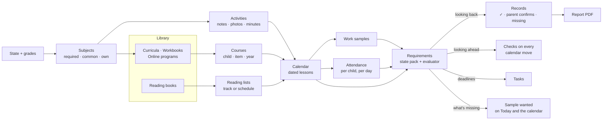

# Product spine

How Curiculy's pieces fit together: the words, the core loop, and what each feature is *for*. Agreed with the owner on **2026-10-11**. **Nothing on this page is built yet** unless it says "today". Feature pages in `2-features/` describe what exists now; this page is where they're heading.

## Why this page exists
Curiculy had many good parts that didn't obviously fit: a pacing engine, lesson-plan imports, evidence capture, portfolios, attendance, a kid trail. The roadmap was spending its time on the edges (the React port, kid extras), while the things that make Curiculy different were marked "out of scope" or "Later". This page puts the core first and gives every part a job.

## The four pillars
1. **A cheaper hub for families who mix programs.** Families who don't use one all-in-one curriculum (BJU, Abeka, Christian Light). Free options like Easy Peasy exist, but they're their own curriculum. State homeschool funding is growing, and more families are building their own mix.
2. **A community catalog.** The hard part of planning is entering each program's lessons. The first family enters a program once (its structure goes to the catalog automatically, reviewed first), and every family after them plans a year in minutes.
3. **State requirements, met and not just explained.** Each state's homeschool law (see [HSLDA's state map](https://hslda.org/legal)) becomes a checklist Curiculy can actually fill from the family's records.
4. **Records that build themselves, FSM-style.** Like a technician attaching photos to a job in field-service software, parents attach work to lessons as they go. Reports show what's there, what's missing, and print as PDFs.

Curiculy still **guides and doesn't teach** ([decision, 2026-10-10](decisions.md)). The parent owns the curriculum; the app is the plan, the nudge and the record.

## Like tax software for homeschooling
The two main selling points:
- **Scheduling several curricula is easy.** There's some setup at the start; after that, the days run themselves.
- **You follow your state's rules and end the year with the right portfolio.**

The model is tax software: it asks plain questions, explains each rule at the moment it matters, keeps a "what's left" checklist, and at the end hands over a finished, checked packet.

| When | What Curiculy does |
|---|---|
| **Sign-up (year setup)** | A guided interview: your state → your kids and their grades → the subjects your state requires for each grade → a one-line objective per subject → a curriculum (or activities) for each subject → schedule it |
| **Through the year** | Today, the calendar and Add work. Records keeps a "what's left" checklist: days, subjects, samples, deadlines. |
| **Each July 1** | "Set up 2027–28": confirm each child's grade, your state, and next year's subjects and curricula. Tasks for anything due (Pennsylvania: the affidavit by August 1). |
| **Year end** | "Build your portfolio": start from your state's preset, adjust it for your evaluator, fix any flags, then print or send |

## The core loop

**One rules engine, two directions.** Looking back, it fills Records ("so far"). Looking ahead, it checks the calendar ("if you make this move"). Because it knows what's missing, it marks upcoming lessons **"sample wanted"**, so parents photograph what's needed instead of everything.

## Words
Parents see: **Today · Calendar · Library · Records · Tasks.**

| Word | Means | Example |
|---|---|---|
| **Library** | Everything the family teaches or reads from, on one bookshelf with filter chips (All · Curricula · Workbooks · Reading books · Online) | |
| **Curriculum** | A program you teach from: its materials plus its full lesson list. Fills one or more subject slots. One meaning only. | BJU Math 5 (4th ed.); Saxon 5/4 |
| **Workbook** | A single consumable book worked through page by page, with chapters | Spectrum Math Grade 3; Explode the Code 2 |
| **Online program** | Lessons done on a website, measured in lessons or minutes; its link opens from the lesson | IXL; Teaching Textbooks; Khan Academy |
| **Material** | One physical item in a curriculum; each can have an ISBN | Student text, worktext, teacher's edition, answer key, test pack |
| **Guide** | A curriculum's lesson list, each lesson pointing at pages in its materials. Part of the community catalog. | "Lesson 42: Text pp. 212–215, Worktext p. 88" |
| **Reading book** | A book to *read*: total pages required, chapters optional | The Lord of the Rings, a biography, a read-aloud |
| **Reading list** | One child's reading books, with started and finished dates and the subject each counts toward | |
| **Course** | One child + one curriculum, workbook or online program + one school year, with weekdays and a start date. A child's courses *are* "their curriculum this year." | Ada · Math · BJU Math 5 · 2026–27 |
| **Subject** | What a child studies, of three kinds: **required** by the state for the child's grade, a **common** preset, or the family's **own**. Curricula and activities belong to subjects. | Math; Safety education; Bible |
| **Objective** | One line per subject, per child, per year, written in setup. Together they make the state's "objectives by subject" outline. | "Finish BJU Math 5: fractions, decimals, early geometry" |
| **Lesson** | One dated item on the calendar: from a course, a scheduled reading book, or a one-off. **Replaces "assignment" everywhere, including the code and API** (cheap now, with no users). | |
| **Activity** | Something logged for a subject without a curriculum: a note, photos, a video or a link, and minutes. Counts like a lesson. | "5K race, PE, 40 min"; "Piano recital" |
| **Work sample** | A photo, scan, PDF or screenshot on a lesson, or on child + subject + date with no lesson | A worksheet; a field-trip photo |
| **Attendance** | Whether each child did school that day (and, in hours mode, for how long) | |
| **Requirement** | One rule from a **state pack**, adjusted for the family's evaluator | "180 days"; "samples of work" |
| **Records** | The dashboard that checks the requirements, and the reports it prints | |
| **Task** | A **parent** to-do with a due date, mostly made by the state pack | "Affidavit due Aug 1"; "Book your evaluator" |
| **Catch-up sheet** | The choices offered when work is missed: push back, use a day off, double up, stretch, skip | "How should Saxon 5/4 catch up?" |
| **Community catalog** | Every book, workbook, curriculum and online program families have entered (structure only), reviewed before others see it | |

**Words we stop using:** "Assignment" (it's a **lesson**); "Curriculum" for a single book or for a child's whole year; "Lesson plan" (it's a **guide**); "Auto-schedule a book" and "Apply" (both become **Schedule**); "Curriculum catalog" (it's the **Library**); "Enrollment" (it's a **course**).

## Subjects: what everything hangs on
- **The state is picked at sign-up** and can be changed in Settings when a family moves. A move takes effect from a date, so each part of the year is checked against the right state.
- **Each child's grade** is picked from a fixed list at setup and re-confirmed every **July 1**.
- **The state's required subjects for that grade appear on the dashboard as slots**, per child: "Math: add a curriculum", "Safety education: add a curriculum or log activities". Families can add **common subjects** (Bible, a foreign language, typing, logic, life skills) or **their own**.
- **A slot is filled by a curriculum, activities, or both.** One curriculum can cover several subjects, or several parts of one (an English program covering reading, writing and spelling).
- **Each subject says what it counts toward.** Presets map automatically. For a custom subject, the parent picks: "Language Arts" counts toward Pennsylvania's English, for example, or it counts toward nothing. The choice is the parent's and is shown plainly (no square pegs).
- **Objectives are written in setup:** one line per subject, starting from a suggestion the parent edits. Together they print as the state's "objectives by subject" outline.
- **Not every subject every year, where the state allows it.**
  - Setup shows the state's rule in plain words and the full subject list for the child's grade band.
  - The parent picks which subjects this year, and can change them in Settings at any time.
  - Subjects covered in earlier years show as **checked** when the next year is set up.
  - The checklist tracks coverage across the grade band, plus anything the state wants every year (Pennsylvania: fire-safety instruction, "regular and continuous").

## Library: one shelf, four kinds of book
One **Library** for everything the family teaches or reads from, with filter chips: **All · Curricula · Workbooks · Reading books · Online**. It looks like a real bookshelf: covers standing on shelves (see [Covers](#covers-a-library-that-looks-like-a-library)). It replaces the "Curriculum catalog".

### Adding something
1. **One search box:** ISBN (typed or scanned), title, author or series. Results come in three groups:
   - **In the Curiculy catalog:** "BJU Math 5 (4th ed.): curriculum, 4 materials, full lesson list." Pick it and it's nearly done.
   - **Book matches** from Open Library or Google Books, with cover, author and page count. Our lookup already returns title, authors, publisher, year, pages, description and cover.
   - **Can't find it? Add it yourself.**
2. **"What is this?"** comes next, with four choices: **Reading book · Workbook · Curriculum · Online program**.
   - **Asked first on a manual entry,** so every question after it makes sense.
   - **After a match, one is pre-selected as a guess,** and the parent confirms it. If the ISBN belongs to part of a known curriculum: "This is the Worktext for BJU Math 5. Set up the whole curriculum?"
3. **The questions for that type,** pre-filled from the lookup where possible.
4. **Add to library,** or **add and schedule**: who, start date, pace.

### What each type asks for
**Anything can be saved to the library unfinished. Nothing can be scheduled until the calendar formula has what it needs** (the "Required" fields). The library card shows what's missing: "38 of 170 lessons still need pages." Every required field says *why* it's needed, in plain words ("Curiculy uses each chapter's start page to keep assignments inside a chapter, and to re-plan when you miss a day"). The parent understands the trade instead of meeting a wall.

#### Reading book (about 30 seconds)
| Field | Required |
|---|---|
| Title, author | Yes |
| **Total pages** | **Yes** |
| Chapters: name and start page for each (typed, pasted, or read from a photo of the contents page) | Optional; it unlocks reading by chapter |
| Kind (novel, biography, poetry, picture book, read-aloud), counts toward | Optional (counts toward Reading by default) |

**Total pages and chapters are separate fields:** pages are required, chapters are not. Scheduled by **pages** ("pp. 41–60"), by **time** ("read 20 minutes"), or by **chapter** ("ch. 3–4"). Chapter is only offered when the chapters are entered. Or **just tracked** on the reading list.

#### Workbook (about 2–5 minutes)
| Field | Required |
|---|---|
| Title, subject (or "several subjects"), grade | Yes |
| **Total pages** | **Yes** |
| **Chapters: name and start page for each,** plus a subject if the book mixes them (typed, pasted, or read from a photo of the contents page) | **Yes** |
| Answer key or appendix pages | Yes, if it has them (they're never scheduled) |
| Numbered lessons (how many) | Yes, if it has them |
| Publisher or series, one per child (consumable), usual pace, minutes | Optional |

#### Curriculum (10–20 minutes the first time; seconds for every family after, from the catalog)
| Field | Required |
|---|---|
| Program name, publisher, edition or year, subject, grade, days a week it's designed for (4 or 5) | Yes |
| **Materials:** kind (student text, worktext, teacher's edition, answer key, tests, reader, video or online), title, pages, **student or parent only** | Yes, at least the student's materials |
| **The full lesson list:** every lesson's **number**, **name**, **type** (lesson, test, quiz, review, project), and its **pages in the student materials**, including quiz and test pages | **Yes** |
| Units or chapters the lessons belong to; teacher's-edition pages; minutes; objectives; grading weights | Optional |

**Without the full lesson list the calendar has nothing to place,** and can't catch up properly after a missed day. Scheduling stays locked until every lesson is in. Ways in, easiest first:
1. the catalog's version
2. import the publisher's lesson plan (PDF)
3. a photo of the contents or lesson-plan pages, read by the vision AI, with a review screen
4. paste or CSV
5. "make lessons 1–170", then fill in names and pages

A live preview shows the result as lessons go in: "170 lessons, 5 a week = 34 weeks, finishes May 21."

#### Online program (about 1 minute)
| Field | Required |
|---|---|
| Name, **website link**, subject, grade | Yes |
| **How it's measured:** by lessons (how many) or by time (minutes a session) | Yes |
| Days a week | Yes |
| A note for the parent ("log in as Ada") | Optional. **Never the password:** Curiculy doesn't store sign-ins for other sites. |

**The link opens from wherever the work shows up:** the lesson on the calendar, the parent's Today and Tasks, and an **Open IXL** button on the kid's trail stop. A screenshot of the score (the Chrome extension) becomes the work sample.

### Scheduling, by type
**"Auto-schedule a book" goes away.** The calendar gets **Schedule from library** (the library, with a type badge on each item), and every library item has its own **Schedule** button. The step fits the type:
- **Reading book:** pages, minutes or chapters a day, or a finish-by date
- **Workbook:** pages a day inside chapter boundaries; never the answer key
- **Curriculum:** follows the lesson list, one lesson a day (or as designed); tests keep their own day; a 4-day program on a 5-day week keeps a **flex day**
- **Online program:** lessons or minutes a day, with the link

Workbooks, curricula and online programs become **courses** (child + item + year). Reading books go on **reading lists**.

### Where they meet
- **A curriculum's lesson can name a reading book** ("Read ch. 1–3 of Charlotte's Web"). The book is linked and lands on the child's reading list.
- **Kid side:** lessons point to the student's materials ("Get your BJU Math 5 Worktext, p. 88"). **My books** shows the child's reading list with the same covers.

### Covers: a library that looks like a library
- **Automatic covers** come from Open Library or Google Books for most ISBNs.
- **Uploaded cover images:** the parent can upload a **real cover image** (a PNG or JPG of the published cover, from the publisher's site, for example) for anything without one. **Not a photo of the book.** It shows in that family's library right away; **every uploaded cover is reviewed by an admin** before other families see it in the catalog.
- **No cover at all:** a generated cover in the subject's color, with the title. The shelf never has a blank.
- **Before launch,** we add cover images for the most-used programs ourselves.
- **The look:** covers standing on shelves, in Morning Light for parents; the kid's **My books** uses Sticker Book.

## Activities: subjects without a curriculum
Many required subjects (PE, music, art, health, safety education) rarely have a curriculum. They're recorded as **activities**.
- **Log an activity** from ＋ or from the subject's slot: which children, which subjects, the date, minutes, a note, and photos, a video or a link. Examples: "5K race, PE, 40 min" with a photo at the finish line; "Piano practice, Music, 20 min"; a drawing for Art.
- **Repeating activities** ("Piano Mon/Wed/Fri, 20 min") appear on the calendar like light lessons, and one tap logs them.
- **Activities count like lessons:** toward subjects, days and hours. Their photos and videos are work samples in the portfolio.
- **Videos:** short clips upload with a size cap, or paste a link (an unlisted YouTube video, a Google Drive file). Work samples already have a link field.
- **Basic first:** notes, attachments and minutes. More only as real needs show up.

## Attendance: per child, one tap
Today: one record per child per day (present, absent, sick, vacation), marked with Yes/No radios in every calendar cell. Nothing is suggested, and there's no "everyone present".
- **A "School today?" card on Today** has one row per child, pre-filled from activity. A child who started or finished a lesson today shows **Present (suggested)**.
  - One tap on **Looks right** confirms everyone.
  - Tap a child to change just them: Sick, Absent, or Field trip (counts as present).
- **Weekly sweep:** "3 days this week aren't marked" opens the same card for each day, pre-filled.
- **Nothing is recorded without a parent's tap.** Whether a day with finished work may count with no tap is an [open question](#open-questions).
- **Days off fill themselves in.** A lesson done on a non-school day asks "Count Saturday as a school day for Ada?"
- **Per child, always:** siblings can differ. On the calendar, each day shows one small dot per child instead of radios.
- **A sick day connects to the calendar:** marking a child Sick offers "Move Ada's lessons from today?"
- **Counts on Today and Records:** "Ada: 92 of 180 days; on track for 181 by June 5." In **hours mode**, a present day adds up its lesson minutes (estimated from the guide or course, and editable).

## Lesson minutes
States that count hours need minutes. Kept simple:
- **A default per course,** asked once at setup ("About how long is a math lesson? 45 min"). Once the catalog has data for that book, it suggests one ("Families say about 40 min").
- **One tap at check-off:** time chips pre-filled with the default (30 · 45 · 60 · other). Also offered when adding work.
- **From the kid's trail:** when a child taps Start and later Done, the time in between is suggested (capped, and editable).
- **Only asked in hours mode.** Families counting days aren't asked.
- **The community learns:** real minutes feed back into the catalog's estimate for that book.

## Calendar: move things, stay within the guidelines
Today: Day, Week and Month views, plus **Recalibrate**, which pushes overdue lessons forward. There's no single-lesson move, no preview, and no checks.

### Guidelines the calendar keeps
- **The family's own:**
  - school days, days off, and the school year's start and end
  - each course's days per week
  - **lesson order within a course**: lesson 43 never lands before 42
  - a daily load per child (lessons or minutes), which is today's "rigorous" flag made into a setting
- **The state's,** from the family's reviewed pack: days or hours planned vs required, required subjects still scheduled, samples per term, deadlines.

### Moves (every one previews before anything changes)
- **One lesson:** drag on a computer, or **Move to…** on a phone, with suggested days. Course lessons are a sequence, so it asks: "Push the rest of Saxon back a day?" or "Just this one" (swapping if needed to keep the order).
- **A day:** "Ada is sick Tuesday" or "We're off Friday". Each affected course moves forward from that day.
- **A course:** change its days per week, pause it (a co-op term, summer), or set a finish-by date. It re-paces.
- **Catch up:** the [catch-up sheet](#the-catch-up-sheet) below.

### The catch-up sheet
There's no single right way to catch up, so Curiculy offers several and the family picks. It opens when a child misses work: from the overdue banner on Today, when a sick day is marked, when a lesson is dragged, or for lessons left unchecked at the end of the day. **Approved design (2026-10-12):** "How should Saxon 5/4 catch up?", with one card per option. Each card says its result in plain words ("Finishes May 28, on time"), and a "What changes" line updates as options are picked. Options will be added or cut as families use it.

**Each option is a formula over the data the family entered:**
| Option | What it does | Needs | Offered when |
|---|---|---|---|
| **Push everything back** | Every lesson from the missed one onward slides forward by the days missed, in order | The lesson list, school days, days off | Always |
| **Push back a whole week** | Restarts the week's lessons next Monday | Same | Always |
| **Use a day off** | Puts the missed work on a day the family doesn't usually school: the flex day first, then weekends if allowed, before the next test or chapter end. Nothing else moves. | School days, days off, "allow weekends" | A free day exists before the next test |
| **Double up** | Adds the missed lesson to a day that already has one, or spreads several missed lessons one per day | The daily lesson limit; lesson types (never doubles on a test day) | A day under the limit exists |
| **Stretch the pages** | Re-paces the remaining pages up to the next chapter end, test or quarter end ("6 pages a day becomes 7") | Total pages and chapter start pages | Workbooks and reading books; online programs by minutes |
| **Skip it** | Marks the lesson skipped | Lesson type | Review and optional lessons |

**Settings on top of any option:**
- **Keep test days where they are:** tests become fixed points, and the catch-up must fit before them. If it can't, the option says so.
- **Allow weekends:** a family setting, and it can be changed per catch-up.
- **What to catch up:** this course, everything the child missed that day, or every child (a family sick day or snow day).
- **How far to look:** to the next test, chapter end, quarter end, or the whole year.

**Making it easy to choose:**
- Only workable options are offered; one that doesn't apply shows why ("Stretch: Saxon's lessons are whole").
- One option is badged as recommended: usually the one that keeps the finish date with the smallest change to any single day.
- **"Remember this for Saxon"** sets that course's default. A family-wide default ("When we miss a day: ask me / push back / use a day off") sits in Settings.
- **A sick day that hits four courses** shows one sheet with each course's default already picked.
- **"None of these fit?"** asks what the family wanted and sends it to the admin queue, so new options come from real use.
- Nothing moves until **Catch up** is tapped; finished lessons never move; any state rule affected is mentioned ("176 of 180 days planned").

**Chapters keep catch-ups tidy:** when work is pushed or stretched, the remaining pages are re-paced chapter by chapter, so a day's assignment ends at a chapter break where possible ("finish Fractions, pp. 58–62"), and the answer key is never scheduled. **The more structure a book has, the more options it gets:** chapter pages unlock Stretch; lesson types unlock Keep test days and Skip; a 4-day design gives a flex day.

Today's **Recalibrate** already does two of these (push back, add weekends); its scheduling logic is reused, not rebuilt.

### Every preview says what the move does, with fixes to choose from
- "Saxon now finishes June 12, after your school year ends June 5." **Add Saturdays in May** · **Double up 7 lessons** · **Extend the year**
- "Ada: 178 of 180 school days planned." **Add 2 days**
- "Tuesday becomes 6 lessons (your limit is 5)."
- "Q2 science still needs 1 sample; 2 science lessons are left this quarter."

**Warnings, not blocks:** the parent owns the plan. The one hard rule is that finished lessons never move.

### A finished lesson sits on the day it was done
Lessons move (sick days, days off, catching up), so the record follows the calendar: **a finished lesson's completion date is the calendar day it sits on.**
- **Checked off on its own day:** done, dated that day.
- **Checked off late** (it's Thursday; the lesson is on Tuesday): one question, "Done on Tuesday, or today?" If today, the lesson moves to today, and nothing after it moves.
- **Done early** (tomorrow's lesson, today): it moves to today.
- **The portfolio's log reads straight off the calendar,** so it's right by construction. This answers Pennsylvania's "log made at the time of instruction".

**Views:** an agenda list on phones; Week and Month on computers; **All Students** shows every lesson, with a filter chip per child.

## Work samples: adding them should take seconds
Parents may add work every day, so this has to be nearly free. **Capture is parent-only for launch:** most kids don't have a device with a camera.

### For launch
1. **Add work, right on the lesson.** The lesson sheet has one big **Add work** button:
   - **Take photo** opens the camera directly
   - **Choose files** takes several photos or a PDF at once
   - on computers, **paste** a screenshot, or **drag files** onto the sheet, or straight onto the lesson's card on the calendar (like dropping a photo on a field-service job)
   
   There are no fields to fill in: the child, date, subject and lesson are already known.
2. **Asked at check-off, only when needed.** Checking off a lesson marked "sample wanted" offers **Snap the work?** One tap opens the camera, and Skip is fine. A setting chooses when to ask: when a sample is wanted (default), every lesson, or never.
3. **Snap the stack.** At the end of the day, open **Today's work**. The camera stays open while you photograph each worksheet in turn. Under each photo, today's lessons appear as chips, best guess first (by child, subject and time). Tap a chip to file it. Anything left over goes to the inbox.
4. **Several pages, one sample.** A three-page test is one work sample, kept and printed together. Phone scanner apps (Notes or Files "Scan documents" on iPhone, Google Drive on Android) already straighten pages into PDFs, and Curiculy takes those as they are.
5. **One photo, every sibling.** On a shared lesson, one photo files onto each child's copy. The upload already accepts an "apply to group" flag; today it ignores it.
6. **An optional line about it:** a caption or a score ("18/20, did it alone"). A score can fill in the lesson's grade.
7. **Uploads never make you wait.** Photos shrink on the phone before sending, upload in the background with a small progress chip, and wait for a connection when offline. iPhone (HEIC) photos are converted.
8. **Mistakes take one tap to fix:** **Move to another lesson** and **Remove** on every sample.
9. **See it build up:** Records shows a gallery per child, subject and term, and "sample wanted" disappears once a sample covers it.
10. **Location stays private:** photos lose their GPS location and camera details when Curiculy re-saves them (checked 2026-10-11). The same check found that phone photos can be stored sideways, because the "rotate" tag is dropped along with the rest; turning them upright first is a one-line fix. PDFs get their metadata scrubbed (PyMuPDF, already installed), and videos are stripped before video uploads open.

### After launch
- **A private upload email address** per family: forward photos to it, or point a home printer's scan-to-email at it. Items land in the inbox with suggestions.
- **Share to Curiculy** from the phone's Photos app. This works for installed web apps on Android; iPhone would need a native app.
- **Read the page number** off a worksheet ("Worktext p. 88") and match it to the lesson that lists those pages, using the vision AI that reads paper plans today.
- **Edge detection and auto-crop** in the in-app camera.

### The Chrome extension
It stays and nothing is deleted. It becomes a **parent tool**: screenshot an online program's results or parent dashboard (IXL, Khan Academy, Teaching Textbooks) into the inbox. It's documented as an optional extra with setup steps.

**Parked:** prompting a *kid* to save a score page. That's only realistic for a curated list of sites (matched by web address plus "score" or "%" text on the page), and it needs per-child sign-in. A short site list would also fix the extension's all-sites permission for Chrome Web Store review.

### The inbox
Anything not filed straight onto a lesson lands in the inbox with a **suggested child, subject and lesson**, from the time and what was due or just finished. One tap files it. The inbox is a safety net, not the main path.

## Requirements, Records and Tasks
- **State packs are data:** versioned and dated ("reviewed 2027-05"), written from the statute and the state's own guidance, linking to HSLDA rather than copying it, with a "not legal advice" note.
- **One state at a time for the hard ones; shared bases for the easy ones.** States with demanding laws (Pennsylvania, New York) each get their own pack. States with similar, light laws share a **base pack**, and each adds only its differences. Every state still gets a worksheet and a review; for a state that matches a base, the worksheet is short.
- **Each pack is built from a few rule types**, confirmed only through review: deadline; subjects by grade band; days or hours; a log kept as you go; reading list; samples per subject per term; tests by grade; evaluator letter; periodic report; and **parent confirms**, the honest fallback.
- **Tasks** are parent to-dos with due dates, made by the pack ("Affidavit due Aug 1", "Book your evaluator", "Certification due June 30") or added by hand.

### Records: three parts
The Records tab (today's Portfolios) holds everything about the rules:
- **Checklist:** each child's "what's left", in three states:
  - **✓ Shown by your records:** worked out from the data
  - **Parent confirms:** a checklist item, with an optional upload where it's safe (see [Privacy](#privacy-keep-the-minimum))
  - **Missing:** each line goes straight to the fix ("Q2 science: 1 of 2 samples. Attach to a lesson")
- **Portfolio:** the report builder (below).
- **Your state:** the state's rules in plain words, with sources, the date they were last reviewed, and the state's official forms.

**The rules are also explained where they matter:** a **Why?** link on each checklist line, setup step and calendar warning opens the matching part of "Your state". **Settings** holds only the choices (state, evaluator adjustments). **Public pages on the website**, one per state, explain the rules before sign-up. They help families who are searching, and they show what Curiculy does.

### The portfolio builder
- **Start from the state's preset** (Pennsylvania: log, reading list, samples, test results).
- **Adjust it for the evaluator,** by subject and date range. For example: Math, work samples, **6**, September 1 – January 31. Evaluators decide how many samples they want, so there's no built-in number.
- **Flags show what's short:** "Math has 4 of 6 samples for Sep 1 – Jan 31." The fix is **Add samples**, or **Change the filter or dates**.
- **The family's adjustments are saved for next year.**
- The output is today's portfolio presets and WeasyPrint PDFs, grown into templates for each state. A blank-slate custom-report designer comes later.

### State forms: we fill what we know, you fill the rest
- Curiculy makes the state's forms (Pennsylvania: the affidavit's parts, the objectives outline) as **fillable PDFs**. The parts Curiculy knows come filled in: the child's name, grade, school year, subjects and objectives.
- **Private fields are flagged and left blank:** birth date, address, phone number, signatures, certifications, health records. Before printing or downloading, Curiculy lists any flagged field still empty ("3 fields to fill: birth date, address, signature").
- **Three ways to fill them, none needing DocuSign:**
  - **in Curiculy's page**, where the PDF is finished in the browser
  - in **any PDF app** after downloading
  - **in ink** after printing
- **None of it is ever saved, or even sent, to Curiculy.** The filled-in PDF is made in the browser and isn't cached, stored or uploaded.
- **Forms with private details aren't emailed through Curiculy.** Our mail service keeps copies of what it sends, so the parent sends the finished PDF from their own email (on phones, through the share sheet). Curiculy's own "Email to evaluator" sends only documents without private details, like the portfolio.
- **Official forms are linked, not copied:** the state's sample affidavits, its diploma form, and so on. The form page shows which parts Curiculy fills.
- **Standardized tests are "parent confirms", with structure:** the test (picked from the state's approved list), the date, who gave it (Pennsylvania: not a parent), and an optional upload of the score report. That report belongs in the portfolio anyway.

## Progress you can see
Progress is part of the core, not a report-only feature. Parents see it as lessons are done, and the portfolio shows the same picture, which is how Curiculy shows "sustained progress".
- **Per course:** lessons done of the total, and on pace or not ("On pace", "3 behind", "Finishing May 28"). The view can be the year, a quarter or a month.
- **Per subject and per child:** the same thing rolled up, including activities and minutes.
- **Over time:** a simple line of lessons done against the planned pace, and work samples spread across the terms.
- **In the app (Morning Light):** progress rings on each child in the stories row, slim bars on course cards, and one-glance "on pace" words. Calm and quiet, never a wall of numbers.
- **In the portfolio:** a clean, professional page per child, printed black on white. It has a table per course of lessons done by quarter, small charts, the subjects covered and the reading list. It's the first thing an evaluator sees.
- **Built on what exists:** today's per-book progress (`GET /api/students/{id}/courses`), grown to terms and subjects. Charts follow the design system and the data-visualization guidance.

## Kept for a child's whole education
**Every family's records are kept for the whole of each child's schooling,** kindergarten through graduation, and that's a selling point: "Your child's whole education, in one place."
- **Compressed:** photos are already shrunk to 1600 px WebP. At three photos a school day, a child's K–12 is roughly 2 GB.
- **Videos are the real cost.** Links are encouraged; uploads are capped and shrunk. Limits or plan tiers can come later if they're needed.
- **A lifetime record:** each child's transcript, reading lists by year, portfolios by year, and work samples, viewable any time and downloadable as one archive. It stays the family's: they can export it, or delete it, whenever they like.

## Privacy: keep the minimum
Curiculy runs on a home server today, and children's data deserves care. The rule: **store only what the app needs to work, and never store sensitive records.**

| Kept | Never stored |
|---|---|
| Each child's first name, grade and color | Birth dates, addresses, phone numbers (typed into form blanks only) |
| Lessons, attendance, minutes, subjects, objectives | Immunization and medical records, exemption letters |
| Work samples: photos, scans, videos or links | Criminal-history certifications, ID numbers |
| Test names, dates and score reports the parent adds; the evaluator's letter | Copies of the filed affidavit (it holds all of the above) |
| A yes/no "has an IEP" flag, only so the state's special-education rules apply | The IEP itself, or any diagnosis |
| | Anything typed into a form's private fields (it never leaves the browser) |

- **Shared automatically, by design:** the structure of books and programs entered by hand goes to the [community catalog](#community-catalog-built-by-every-family) after review. Never anything about the family; privacy checks catch children's names and contact details before an admin sees it.
- **Sensitive items are a checkbox and a date,** with no upload ("Affidavit filed July 28"). The "Your state" page says where to get each record (immunizations from the child's doctor or the state's immunization registry, and so on) and reminds the parent to keep their own copies safe.
- **Photos of children are the most sensitive thing Curiculy keeps.** They're private to the household, location data is stripped, size is capped, and they can be deleted at any time.

## Grades 9–12 and special education (in scope)
- **High school:** courses in grades 9–12 carry credits and a final grade. Curiculy keeps a running **transcript** and checks it against the state's graduation rules (Pennsylvania: 4 years of English, 3 of math, 3 of science, 3 of social studies, 2 of arts and humanities).
- **Diplomas:** Pennsylvania lets the supervisor award a state-recognized diploma on the state's form (PDE-6008), signed by the 12th-grade evaluator. Curiculy runs the checklist and links the form.
- **Special education:** with the IEP flag on, the state pack adds its rules. In Pennsylvania, the program must be approved by a certified special-education teacher or a licensed or certified school psychologist, with written notice of the approval filed with the affidavit. These become "parent confirms" items and Tasks.

### No square pegs
When a requirement asks for something Curiculy doesn't have, we don't squeeze it into the nearest field. We stop, review it with the owner, and decide: a correct mapping, a new feature, or "handled outside Curiculy". Curiculy never shows a ✓ it can't actually check. The process and each state's worksheet are in [State requirements](state-requirements/README.md). **Pennsylvania is first** ([worksheet](state-requirements/pennsylvania.md)); New York is likely next (its yearly plan and quarterly reports can be generated from courses).

## Community catalog: built by every family
The catalog of books, workbooks, curricula and online programs is what makes Curiculy fast to set up, so **every family's entries build it.**

### How contributions work
- **No share toggle.** When a family adds a reading book, workbook, curriculum or online program by hand, its **structure** goes to the catalog automatically, after review: title, author, publisher, edition, ISBN, total pages, chapters and their start pages, materials, the lesson list (numbers, names, types, pages), and the cover image.
- **Never shared:** anything about the family or a child, schedules, progress, notes, work samples, and which family contributed (kept only for review).
- **A plain notice says so** where books are added, and in the terms: "The book details you enter (never anything about your family) help every family using the same book." That wording, and sharing cover images, go on the lawyer's list before launch.
- **Founding families get major discounts** for their first couple of years, for building the catalog, the way community databases reward early contributors.
- **Families aren't forced to use catalog versions.** A family can always enter or edit its own copy; its edits are contributions in turn.
- **Keyed to ISBN and edition:** "4 families have entered this book. Use it?" Reading books share chapters at the work level, so they hold across editions. We seed the most-used mix-and-match programs ourselves before launch, including single BJU and Abeka subjects.

### Automatic checks
Each check is a small rule that raises a flag with a plain-words reason. Structural checks also run inline while the family types, for the family's own sake.

| Group | Flags |
|---|---|
| **Structure** (would break scheduling) | Chapter start pages out of order, overlapping, or past the total pages; lesson numbers missing or repeated; lesson pages out of order or past the material's pages; "170 lessons" with 12 entered; answer key inside the lesson range; impossible values (9 days a week, a 600-minute lesson) |
| **Identity** | ISBN fails its checksum, or Open Library says it's a different title or author; total pages more than ~10% off the published count; edition year doesn't match the ISBN; a duplicate of a catalog entry (becomes a **merge candidate**); publisher name variants normalized |
| **Privacy** | Text containing **the family's own children's names** (Curiculy knows them); email addresses, phone numbers, street addresses; a face in an uploaded cover image |
| **Spam and junk** | **Keyboard mashing** ("gbnuicnrnkfnsknduscn"): long consonant runs, letter pairs that don't occur in real words, few recognizable words, repeated characters; numbers and titles like "Saxon 5/4" are fine. Also profanity, links in text fields, all-caps |
| **Copying** | Long blocks of text in lesson names (could be teacher's-guide text, a copyright risk) |
| **Covers** | **Every uploaded cover is reviewed.** Also flagged: too small, mostly blank, wrong shape, the same image reused |
| **Online links** | Not `https`, link shorteners, domains not on a known list of education sites |
| **Behavior** (context, not a verdict) | First-time contributor; 170 lessons entered in 30 seconds; many entries in an hour; earlier rejections |
| **Agreement over time** | Several families' versions of the same ISBN that match raise confidence; one far from the rest is flagged; a published entry many families change the same way ("30% changed Lesson 42's pages") is flagged for a correction |

**Three levels:**
| Level | Who sees it | Example |
|---|---|---|
| **Fix before saving** | The family, inline | Chapters out of order; a title that's keyboard mashing ("That doesn't look like a real title. Fix it?") |
| **Needs review** | An admin, in the queue | A child's name, an uploaded cover, an ISBN mismatch, a link |
| **Note** | An admin, for context | A first-time contributor, a 6% page mismatch |

The family's own copy works either way. Only the catalog waits for review.

### The admin review queue
In Settings → Admin, next to invites:
- **Each contribution** shows its flags with reasons, a side-by-side comparison with the catalog entry or the ISBN data, and the cover.
- **Actions:** Approve · Approve with edits · Merge into existing · Reject with a reason · Ask the contributor.
- **At launch everything is reviewed;** later, clean contributions from trusted contributors can publish on their own, and only flagged ones wait.
- **Every catalog entry is versioned,** with who approved each version, and can be rolled back. Families who already use an entry keep their copy and are **offered** a correction, never forced.
- **Catch-up feedback** ("None of these fit?") arrives in the same queue.
- **Under the hood,** contributions and flags live in shared tables, like the book cache: deliberately outside any one family's walled-off data, with the contributor recorded for review only.

## Data model changes
**There are no real users yet** (invites haven't gone out), so the model can be redesigned cleanly, with no backfills. Final table names are settled when each piece is built.

| Today | Becomes |
|---|---|
| `curricula` + `curriculum_editions` | **Library item** with a **kind**: reading book, workbook, curriculum or online program (title, author, publisher, edition, subject, grade, total pages, website link, how it's measured, cover) |
| `curriculum_units`, `curriculum_page_mappings` | **Chapters** (name, start page, optional subject) for reading books and workbooks |
| `curriculum_resources` | **Material** of a curriculum (kind; ISBN linked to the shared `book_editions`; pages; student or parent) |
| `curriculum_plans`, `curriculum_lessons` (unconnected to books) | **Guide** + **guide lessons** for a curriculum (number, name, type, pages per material, unit, minutes, optional reading-book link) |
| none | **Reading-list entry** (child, reading book, status, started and finished dates, counts toward, optional schedule) |
| `enrollments` | **Course** (child, library item, school year, weekdays, start date, pauses, default minutes, **catch-up default**; credits and final grade in grades 9–12) |
| `assignments` | **Lesson** (renamed in code and API): adds its course, its place in the sequence, subject, minutes, and an optional reading-book link. A finished lesson's completion date is its calendar day. |
| none | **Subject** per child (required, common or own; counts toward a state subject) and **objective** per subject per year |
| none | **Activity** (children, subjects, date, minutes, note, attachments or links); repeating activities |
| `attendance` | adds how it was set (suggested or confirmed) and minutes |
| `school_years` | adds terms (quarters) |
| `assignment_evidence`, `evidence_staging` | **Work sample** (child, subject, date, optional lesson, pages, caption); inbox items carry suggestions |
| `subject_taxonomies`, `reporting_categories`, `curriculum_classifications` (empty or unused) | one fixed **subject** list; each state pack maps its subjects onto it |
| `jurisdictions`, `compliance_packets` (placeholders) | **Requirement packs** (shared, versioned), the family's chosen pack with evaluator adjustments, and **Tasks** |
| `household_settings` | adds a daily load limit and days-or-hours mode |
| `households` | adds the **state**, with the date it applies from (a move adds a new one) |
| `students` | grade from a fixed list, re-confirmed each July 1; a yes/no IEP flag. **No birth date**: ages go into form blanks only ([Privacy](#privacy-keep-the-minimum)). |
| the shared book cache | becomes the **community catalog**: catalog entries (versioned) for all four kinds, their chapters, materials and lesson lists, and cover images |
| none | **Contributions** and their **flags** (shared tables, outside any family's data; contributor kept for review only), the admin review queue, and catch-up feedback |
| `household_settings` (again) | the family-wide catch-up default and "allow weekends" |

**Data tier: Postgres** ([decided 2026-10-11](decision-records/data-tier.md)), one database with each family walled off by row-level security, built before the spine.

## Order of work
| When | Work |
|---|---|
| Oct–Dec 2026 | Data-tier decision; then the backend spine: state and grades → subjects and objectives → the Library's four kinds (chapters, materials, lesson lists, required-field rules, search-first adding, covers) → reading lists → Course → Lesson rename, minutes and terms → activities → attendance suggestions → move engine with previews, the **catch-up formulas** and the plan checker → requirement packs and Tasks → the **Pennsylvania pack** (after its worksheet is reviewed) → the Records API, progress by course, subject and term, and the portfolio builder → inbox suggestions → community catalog checks and the admin review queue → transcript and credits → photo orientation fix and PDF metadata scrub |
| Jan–Mar 2027 | The loop's screens, built **directly in React**: the **year-setup interview**, Today ("School today?", Tasks, overdue banner, "sample wanted"), Calendar (drag and Move to…, previews, warnings, **Schedule from library**), the **catch-up sheet**, the **Library bookshelf** (search-first adding, four kinds, covers), the **admin review queue**, lesson sheet (Add work), Log an activity, Records (Checklist, Portfolio, Your state), progress rings and course bars, kid's My books. Fillable state forms (filled in the browser). The community catalog, seeded with the most-used programs and their covers. Public state pages. |
| Mar–May 2027 | Second wave of states: New York on its own, then a base pack for states with similar light laws; the lifetime archive download; extension docs; launch work (Phase 8). Feature freeze mid-May. |
| Jun 2027 | Launch with an honest "N states supported" claim and a seeded guide catalog |

**Scope check:** "everything in scope for a state's portfolio", including transcripts, diplomas and special education, is a lot for one developer by June. Pennsylvania must ship complete; other states join only once their worksheets are reviewed, and the launch claims only those.

## Parked until after launch
Cheers from home and more kid extras; kids capturing their own work; the kid score-snap extension idea; a generic custom-report designer; the upload email address; Share to Curiculy; page-number matching.

## Open questions
- **Attendance:** may a day with finished work count automatically, with no parent tap?
- **Several states at once:** sign-up allows picking "state(s)". Beyond a move partway through the year, is there a case for two states at once (for example, a family split between homes)?
- **Pricing:** **founding families get major discounts for their first couple of years** for building the catalog (decided). Still open: the split between a free tier (planner and catalog, to grow it and compete with free options) and paid (requirements, Records, work-sample storage), and the numbers. Check competitors' prices first.
- **State funding (ESAs):** can Curiculy be an eligible expense, and are ESA record rules a kind of pack?
- **Pennsylvania:** a few wordings to [confirm against the statute](state-requirements/pennsylvania.md#still-to-confirm-against-the-statute).
