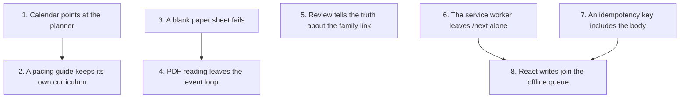

# Technical debt

A sequenced plan for the debt found on **2026-10-23**. The costly part is two replacements that are both still live: three writers that put lessons on the calendar, and a React app served beside the legacy shell. Each section below is one pull request. The commits inside it are the reviewable slices. Land them in order. A later pull request assumes the earlier ones have merged.

This is the work plan. The prioritized inventory stays in [Open issues](open-issues.md). The dates stay in the [Roadmap](roadmap.md). An older `TECHNICAL_DEBT.md` at the repo root was retired when this handbook replaced it (commit `51cce3b`); this page does not restore that file.

No families use Curiculy yet. That is why the later schema work can wait for the React calendar, and why these pull requests must still be safe on the pre-beta server the owner already runs. None of the eight pull requests below deletes a table.

## How to land one of these

- One pull request per section. Suggested branch names are under each heading.
- Commit messages follow the repo: one plain sentence about what changed and why. The subjects below are ready to use.
- When a pull request changes what a parent sees, update the feature page it names, and strike or rewrite the matching row in [Open issues](open-issues.md).
- When a pull request changes a route, regenerate the client (`npm run gen:api` in `frontend/`) and let CI confirm `frontend/src/api/schema.d.ts`.
- Leave the items in [Later, on purpose](#later-on-purpose) out of these branches.

Pull requests 1–2 are one chain. 3–4 are a second chain and can run beside the first. 5 stands alone. 6 and 7 both have to merge before 8.

## What is already in good shape

Leave this alone while doing the list.

- Family rows go through a tenant session. Startup checks the wall. `tests/test_database.py` compares models to migrations.
- `frontend/openapi.json` is generated from the app, and CI fails if `schema.d.ts` drifts.
- "Today" is `household_today(db)`. Import direction is guarded by `tests/test_import_order.py`.
- Known problems already live in [Open issues](open-issues.md). There is no `TODO` litter to mine.
- The React source has no `any` or `ts-ignore` outside the generated schema.

## The two stacks, so the pull requests stay aimed

Lessons are dated by three writers. They do not share an identity.

| Writer | Entry | What a lesson points at |
|---|---|---|
| Curriculum planner | `POST /api/planner/.../schedule` in `app/services/planner.py` `schedule` | `Assignment.course_id` → `courses` → `planned_curricula`, plus `library_item_id` |
| Auto-schedule | `POST /api/pacing/commit` in `app/services/pacing.py` `SyllabusCommitter._write` | `Assignment.curriculum_id` plus a resource and a unit on the old `curricula` tables |
| Apply a pacing guide | `app/services/curriculum_plan_apply.py` `apply_curriculum_plan` | `Assignment.curriculum_id` only. The guide stores its own `curricula` row (`curriculum_plans.curriculum_id`); it does not match by title |

`Course.curriculum_id` points at `planned_curricula`. `Assignment.curriculum_id` and `Enrollment.curriculum_id` point at `curricula`. The columns share a name and do not share a table. A later foreign key has to pick one of those meanings. Pull request 2 does not try to.

Consequences that are live today:

- Two pacing guides titled "Math" used to share one `curricula` row. As of 2026-10-23 each guide keeps its own. Lessons from a deleted catalog row still hold the old id, because `assignments.curriculum_id` has no foreign key.
- Deleting an old curriculum looks for resource and unit ids (`_scheduled_curriculum_ids` in `app/routers/curricula.py`). A guide that was applied sets only `curriculum_id`, so that curriculum looks unscheduled and can be deleted while its lessons remain. There is no foreign key to stop the dangling id.
- A portfolio book is grouped with `Assignment.resolved_curriculum_id()` (`app/models/education.py`). Planner lessons have `course_id` and no `curriculum_id`, so they do not appear as books. That wait is [Later, on purpose](#later-on-purpose), because the portfolio should follow the planner's course once the calendar moves.

Screens, as of this review:

| On React (`/next`) | Still the legacy app (`/`, hash routes) |
|---|---|
| My trail, Sticker journal | Sign-in |
| Library, Curriculum planner | Home, Calendar, Kids, Portfolios, Settings |
| Reading, Activities, Attendance | The old catalog at `#/curricula` (out of the nav, still a real page) |
| Catalog review | |

## 1. The calendar sends scheduling to the planner

**Branch:** `planner-not-auto-schedule`

**Why first:** Every week the calendar offers "Auto-schedule a book", new lessons are written in the shape the planner does not own. Taking the button off stops that. The pacing API stays, so this pull request has no migration.

**Done when (landed 2026-10-23):** The calendar toolbar and the old catalog cards no longer call `openAutoSchedule`. The pacing dialog is gone with them, because nothing else opened it. `#/curricula` still loads, because CSV import, the PDF import, and the lesson-plan builder still live there until a later retirement.

**Checked, and left as it was:** a `curriculum_plan_ready` or `curriculum_plan_failed` notification still opens `#/curricula` on the plans tab. `/next/planner` lists library curricula (`PlannedCurriculum`). It does not list pacing guides (`CurriculumPlan`). Sending the notification to the planner would hide the guide that just finished, which is the page the CSV smoke test still uses.

### What changed

- The calendar toolbar links to `/next/planner` ("Schedule from the planner") for one child and for All Students.
- Old catalog cards keep **Remove from schedule** and **Delete**. The Auto-schedule buttons are gone.
- `openAutoSchedule`, the `#pacing-modal` markup, its listeners, and the preview CSS are gone. `fillSelect` stays; the lesson editor uses it.
- `POST /api/pacing/generate-preview` and `POST /api/pacing/commit` stay. Backend tests still call them.
- `SHELL_VERSION` is `20261023-planner-link`.

### Leave for later

- Deleting `/api/pacing/*`, `SyllabusCommitter`, or the `curricula` tables.
- Moving CSV, PDF, or the builder off `#/curricula`. Apply stays on that page, which is why pull request 2 is next.
- **Books in motion** on the Kids page still counts only lessons with the old `curriculum_id`. Planner courses do not show there. That was already true, and this pull request does not invent a second progress list to paper over it.

## 2. A pacing guide keeps its own curriculum row

**Branch:** `plan-owns-curriculum`

**Depends on:** pull request 1 merged, so new Auto-schedule rows are no longer arriving while this migration is reviewed. Apply is still on `#/curricula`, and this is the bug Apply still has.

**Why:** `curriculum_for_plan` (`app/services/enrollments.py`) used to reuse the oldest `curricula` row with the same title. Two guides named "Math" shared a curriculum, an enrollment, and a delete target.

**Done when (landed 2026-10-23):** Applying a guide creates a `curricula` row once, stores that id on the plan, and reuses it on the next apply. A second guide with the same title gets its own row. A catalog book that already has that title is left alone. Existing collisions are not split. There is no backfill.

The plain foreign key is not enough. `curriculum_plans` and `curricula` are both family tables, and `app/db_safety.py` refuses a family-to-family reference that can point at another family's row. The migration also adds `fk_tenant_curriculum_plans_curriculum_id` on `(tenant_id, curriculum_id)`. `ON DELETE SET NULL` clears `curriculum_id` only.

### What changed

- Migration `20261023_0010_plan_owns_curriculum`: nullable `curriculum_plans.curriculum_id`, the plain foreign key, and the family-matching twin.
- `curriculum_for_plan` returns the stored row, or creates one and stores its id. No title search.
- Tests in `tests/test_enrollments.py`: a same-titled catalog book is not reused, two "Math" plans get two rows, a second apply reuses the stored id, and deleting the curriculum clears the pointer while the first apply's lessons keep the old id.

### Leave for later

- A foreign key from `assignments.curriculum_id` to `curricula.id`. That stops the dangling id, and it also blocks deleting a curriculum that still has lessons. That change belongs with the calendar rebuild, when one identity owns every lesson.
- Teaching the portfolio about `course_id`.

## 3. A blank paper sheet is a failed plan

**Branch:** `paper-import-fails-empty`

**Depends on:** nothing in the chain above. Can be reviewed in parallel with pull requests 1–2.

**Why:** [Open issue 3a](open-issues.md) already decided not to install the vision model, and to retire handwriting import when the old catalog page goes. A sheet that yielded no lessons was stored as ready. The PDF worker marks that case failed.

**Done when (landed 2026-10-23):** The old catalog no longer offers "photograph a paper template" or the template download. A paper job that persists zero lessons marks the plan failed and sends the failed notification. The HTTP routes stay, so a request already sent can finish, and it can no longer report success with an empty guide. Plans already titled "Paper Import" still say so in the list. The general plan-status poll covers a job started through the route, so the paper-only poller is gone with the buttons.

### What changed

- `_persist_lessons` returns `failed` and does not change `total_weeks` when no lesson titles come back.
- The catalog heading keeps Create, CSV, and PDF. The paper buttons, the hidden file input, and the paper poller are gone.
- A failed plan titled "Paper Import" says to edit it by hand or delete it. It does not offer another photo.

### Leave for later

- Deleting `GET /api/curriculum/paper-template`, `POST /api/curriculum/import-paper`, and the parser, template, and worker. See [Later, on purpose](#later-on-purpose).

## 4. PDF reading leaves the request event loop

**Branch:** `pdf-import-off-loop`

**Depends on:** pull request 3, only so the two importer fixes are not one diff. The code does not require it.

**Why:** `import_curriculum_pdf` in `app/routers/curriculum_plans.py` returns 202 and registers `process_pdf_curriculum_background`. That function is `async`. It calls synchronous `extract_text_from_pdf` (`app/services/pdf_parser.py`: PyMuPDF, then Tesseract, up to `MAX_OCR_PAGES = 20`) directly, so the work runs on the API event loop. It then `await`s `parse_text_with_ollama`, which calls `chat_with_model_fallback` (`app/services/ollama_chat.py`) with no timeout. The paper worker's HTTP calls use `timeout=120`. One PDF can stall every other request on the process. [Open issue 8](open-issues.md) is a jobs table at phase 8. This pull request is the smaller fix the live path needs.

**Done when:** Text extraction runs in a worker thread. The Ollama chat for this import gives up after a bounded wait, the plan is marked failed, and the failed notification is sent. The route still returns 202 before that work starts.

### Commits

1. `PDF text extraction runs off the event loop.`
   - In `process_pdf_curriculum_background`, call `extract_text_from_pdf` through `asyncio.to_thread` (Starlette's `anyio.to_thread.run_sync` is the same idea; match whichever the file's neighbors use).
   - Do not mark the route `def` and do the extraction before the 202. The parse of the upload bytes (`await file.read()`) stays on the request. The OCR does not.

2. `The curriculum PDF chat has a timeout.`
   - `ollama==0.6.2` builds an `AsyncClient`. Give the client used by this import a finite timeout (120 seconds matches the paper worker). Prefer a parameter on `chat_with_model_fallback` so homework-help and other callers keep their current wait unless they opt in. This commit opts in only the PDF worker.
   - On timeout, the existing `except Exception` in `process_pdf_curriculum_background` already sets `failed` and calls `_mark_plan_failed`. Confirm a timeout is an exception that path sees, and add a test that a raised timeout marks the plan `failed`.
   - `tests/test_curriculum_pdf_import.py` patches `parse_text_with_ollama`, so it never proves the thread hop. Add one test that patches `extract_text_from_pdf` and asserts the worker still persists lessons. Patching the function is enough. A test that inspects the running loop is brittle; do not add one.

### Leave for later

- A jobs table, retries, or a second process. Phase 8.
- Moving `parse_paper_upload` off the request. Pull request 3 removed the buttons. The deletion pull request removes the call.

## 5. Catalog review tells the truth when the family link fails

**Branch:** `review-links-the-family`

**Depends on:** nothing. Review it on its own. It touches shared catalog writes.

**Why:** `approve` and `_approve_curriculum` in `app/services/community_review.py` commit the catalog session, then call `_tell_family`. `_tell_family` commits the contributing family's session inside `except Exception`, logs, and returns. The HTTP response is still success. The contribution is already closed, so the admin cannot retry the link. `adopt_entry` in `app/services/community.py` has the smaller version: the library copy commits, then `families_count` commits on the other session.

These are two sessions because the catalog role and the family role are different. They will not become one database transaction in this pull request.

**Done when:** If the family's own row is not updated, the contribution stays open and the admin gets an error. A retry runs the review again. Adopting a catalog entry still keeps the family's copy when the count update fails, and the response says the count did not move.

### Commits

1. `Approving a contribution links the family before the review is closed.`
   - Flush the catalog entry so it has an id. Do not commit yet.
   - Run the family change (`_link_item` / the curriculum `change` callback) and commit the family session.
   - If that raises, roll the catalog session back, leave the contribution open, log the exception, and raise a domain error the router turns into 503 with a plain detail such as "The catalog entry was not published, and the family was not linked. Try the review again."
   - Commit the catalog session only after the family commit returns.
   - If the catalog commit fails after the family commit succeeded, log it and return 500. Say in the detail that the family's copy was linked and the review should be retried. `_require_open` will still see an open contribution, and the link callback is safe to run again (`session.get` and set the same id). Document that residual in a comment on `_tell_family`. Delete the "a failure here never undoes the review" sentence. It described the bug.
   - Do this for both `approve` and `_approve_curriculum`, and for `merge` if `merge` uses the same helper. Read `merge` before editing. It calls `_tell_family` too.

2. `Adopting a catalog entry reports a failed family count.`
   - Keep the current order in `adopt_entry`: commit the family's `LibraryItem`, then increment `families_count`.
   - If the catalog commit raises, log it and raise an error the router maps to 503. The item is already committed. `_your_copy` makes a retry return the existing item with `counted=False`, so a second copy is not created. The 503 tells the client the count did not move.
   - `create_curriculum` in `app/routers/curricula.py` commits `catalog_db` and then `tenant_db`. Swap that to the family commit first. If the family commit fails, roll both back and return the error, and the catalog has no orphan because it was not committed. If the catalog commit fails afterward, the family curriculum exists: log the cache miss and still return 201. A 400 after a committed family row would make a retry insert a second curriculum. Note that in the commit message.

### Tests

`tests/test_community.py` injects a working `open_family`. Add:

- `open_family` raises after the catalog flush and before the catalog commit. The contribution is still open. The catalog has no new published entry from that attempt. The response is 503.
- The same review, retried with a working opener, approves once and links `LibraryItem.catalog_entry_id`.
- `adopt_entry` when `catalog_db.commit` raises: the `LibraryItem` remains, `families_count` is unchanged, the response is 503, and a second adopt returns that same item.

### Docs

- [Community catalog](../2-features/23-community-catalog.md): a failed family link leaves the review open.

## 6. The service worker leaves `/next` alone

**Branch:** `service-worker-skips-next`

**Depends on:** nothing. Must merge before pull request 8. Offline React is worse if a failed navigation is answered with the legacy home page.

**Why:** `static/js/app.js` registers `/sw.js` for the whole origin (`Service-Worker-Allowed: /` from `app/main.py`). The fetch handler in `sw.js` is network-first for every same-origin GET except `/api` and `/evidence`, and it stores the response in `curiculy-shell-${SHELL_VERSION}`. On a network failure, a navigation with no cache entry falls back to `caches.match("/")`, which is the legacy shell. The address bar still says `/next/trail`. The legacy router is hash-based, so that document opens Home. `activate` deletes every cache other than the current shell cache, so a version bump also drops any `/next` assets that had been stored there.

Playwright sets `serviceWorkers: "block"` (`e2e/playwright.config.ts`), so the browser suite will not catch this. `tests/test_shell.py` reads `sw.js` as text. Extend that.

**Done when:** A request whose path is `/next` or starts with `/next/` is ignored by the worker (the handler returns without `respondWith`). Those responses are not written into the shell cache. The legacy shell's offline behavior is unchanged.

### Commits

1. `The service worker does not answer /next navigations.`
   - At the top of the fetch handler, after the method and origin checks, return when `url.pathname === "/next" || url.pathname.startsWith("/next/")`.
   - That single return also skips `cache.put`.
   - The navigate fallback to `/` stays for legacy navigations.
   - Bump `SHELL_VERSION` and the matching query strings. `tests/test_shell.py` checks the token, the `SHELL_URLS` list, and that the worker file still contains the cache name. Add an assertion that the fetch handler returns before `respondWith` for a `/next` path. A text assertion is the style of this file: search for the pathname check and fail if it is missing. Do not execute the worker.

### Docs

- [Offline and sync](../2-features/16-offline-and-sync.md): the worker covers the legacy shell. `/next` is network-only until pull request 8, and even then the worker stays off those URLs. React offline is the page's queue, the same rule the worker's header comment already states for writes.

## 7. An idempotency key includes the request body

**Branch:** `idempotency-body-hash`

**Depends on:** nothing. Must merge before pull request 8, because that pull request replays a stored key and a mismatched body must not replay the first response.

**Why:** `IdempotencyMiddleware._replay` in `app/core/idempotency.py` compares `stored.method` and `stored.path`. The same key on the same path with a different JSON body is answered with the stored response and `Idempotent-Replayed: true`. `tests/test_idempotency.py` refuses a key reused on a different path (`test_a_key_reused_for_another_request_is_refused`). It does not try the same path. `IdempotencyRecord` stores `principal`, `key`, `method`, `path`, `status_code`, `content_type`, and `body` (the response body). There is no request hash. The in-memory lock (`_locks`) still assumes one process. That part is [open issue 11](open-issues.md) and stays out of this pull request.

**Done when:** A new record stores a hash of the raw request body. A replay whose hash differs gets 422 and the same detail the path mismatch already uses. Rows written before the migration have a null hash and keep today's behavior for the two-day retention window.

### Commits

1. `Idempotency records remember a hash of the request body.`
   - Nullable `idempotency_records.request_sha256`, `String(64)`. This table is admin data (`AdminBase`), not a family table. No tenancy policy.
   - When storing, hash the exact bytes the middleware already captured. Use SHA-256, hex. An empty body hashes as the hash of empty bytes, so "no body" and "body we failed to read" must not collapse: if the body was not captured, store null, and treat null on a new request as a mismatch only when the other side is non-null. Be explicit in the code: both sides null means the old row, allow replay; one side null means refuse.

2. `Reusing an idempotency key with a different body is refused.`
   - `_replay` checks the hash after the method and path check, and returns 422 with the existing sentence: "This Idempotency-Key was already used for a different request."
   - `tests/test_idempotency.py`: same path, same key, different JSON. Expect 422 and one row created. Same path, same key, same body. Expect the replay header and one row. An old row with a null hash still replays. Build that row through the model in the test database rather than a second code path.

### Leave for later

- Hashing multipart bodies. Decide in the test what the middleware currently stores for a file upload. If the body is skipped above `MAX_STORED_BODY`, the request hash should still be computed from the bytes even when the response is not stored. Read `MAX_STORED_BODY` before writing the hash so a large PDF import does not change status codes. Imports send `skipOutbox` on the client. They may still send `Idempotency-Key` from the React middleware, which sets a key on every non-GET. If a large body is not retained, document the chosen rule in a comment: either skip idempotency when the body exceeds the cap (today's practical behavior) or hash it and refuse to store the response. Do not silently treat two large bodies as the same request.

## 8. React writes join the offline queue

**Branch:** `react-writes-use-outbox`

**Depends on:** pull requests 6 and 7.

**Why:** `sw.js` says offline writes belong to the page, because replay has to attach the current sign-in and the worker must not keep a token. `static/js/app.js` does that. `shouldQueueRequest` queues mutating calls through `api()`, including `PATCH /assignments/{id}/status`. The store is IndexedDB `curiculy-sync` version 2, object store `outbox`, `keyPath: "id"`. A record is `{ url, method, headers, bodyKind, body, owner, status, attempts, createdAt }`. Headers have no `Authorization`. `owner` is `tokenOwner`: `tenant:sub:student` (demo households use `DEMO/<jti>`). Replay reuses `Idempotency-Key`.

`useSetLessonStatus` in `frontend/src/api/queries.ts` updates the React Query cache and restores it on error. It never opens the database. Attendance confirm, library saves, and planner schedule in `frontend/src/api/parent.ts` go through `openapi-fetch` the same way. A child on My trail sees "That didn't save". The same status change on My work is queued. The React app also has no sync line, so a queued legacy change disappears once the parent is on `/next`.

**Done when:** A failed or offline JSON write from React is a row in that same object store, flushed by whichever shell is open. The idempotency key is chosen once and reused for the replay. Signing out still clears the queue, using the legacy rule (the queue belongs to the account). Multipart uploads are not queued in this pull request.

### Commits

1. `The offline queue lives in static/js/outbox.js.`
   - Move `openSyncDb`, the store constants, `enqueueOutboxRequest`, flush, the failed list, and `tokenOwner` into `static/js/outbox.js`. Attach them as `window.curiculyOutbox`.
   - `app.js` calls that object. The sync pill DOM (`#sync-pill`, `paintSyncStatus`, the toast) stays in `app.js`, and it asks the outbox for counts.
   - No record-shape change. `SYNC_DB_VERSION` stays 2.
   - `e2e/tests/offline.spec.ts` is the proof: go offline, queue, sign out and empty, reconnect and apply once. Those tests hit the legacy app. They must pass unchanged. That is how this commit shows the extract was a move.

2. `A React write uses the legacy outbox when the network fails.`
   - Load `/static/js/outbox.js` from the React `index.html` before the module script, the same way the legacy page loads a classic script. Do not bundle a second copy into the Vite chunk. One implementation is the point.
   - In `frontend/src/api/client.ts`, the session middleware already sets `Authorization` and a fresh `Idempotency-Key` on every non-GET. Change that so the key is stable for a given attempt that will be replayed: generate it in the mutation caller (or once per `fetch` invocation, before any retry) and pass it through. A replay must send that same header. Today a new key on every `onRequest` means a retry is a second write once the server has no matching key. Pull request 7 makes a mismatched body safe. This commit makes the key actually repeat.
   - On `navigator.onLine === false`, or on a `TypeError` from `fetch`, and only for JSON bodies, call `window.curiculyOutbox.enqueue` with the same record shape. Skip `FormData`. The legacy `skipOutbox` list (imports, nudges, sign-in) is the model. React has no import call on this client. Activity photo upload stays a direct call with the retry `ActivityForm` already has.
   - `useSetLessonStatus` keeps its optimistic cache update. On a queued result, do not roll the checkmark back. On a 4xx, roll it back, matching the legacy "couldn't be saved" rule.
   - `goToSignIn` currently assigns `/` and leaves `auth_token` in `localStorage`. `handleUnauthorized` in `app.js` clears the token. Clear it in `goToSignIn` before the navigation, or a later replay attaches a dead token. Legacy sign-in then shows the modal because the token is gone. That matches `handleUnauthorized`.

3. `The React shells show how many changes are waiting.`
   - A single line on `ParentShell` and on `KidHeader`, read from `curiculyOutbox` counts for the current owner. The legacy pill's words are the ones to reuse, so the two shells do not invent a second phrase. Wire the line to the same flush the legacy page runs when `online` fires.
   - Kid pages and parent pages both mount one of those two components. Trail and journal do not use `ParentShell`.

### Tests

- A frontend test with the IndexedDB fake (or a thin mock of `window.curiculyOutbox` if jsdom has no IndexedDB) on `useSetLessonStatus`: a network `TypeError` calls enqueue once, the optimistic lesson stays checked, and the stored key equals the key on the request.
- A second call with the same variables after a queued failure does not enqueue a second row for the same key.
- `client.test.ts` today only checks key shape. Extend it for "one key per write attempt".
- Do not add a Playwright service-worker test. Pull request 6 kept the worker off `/next`, and Playwright blocks workers anyway.

### Docs

- [Offline and sync](../2-features/16-offline-and-sync.md) and [My trail](../2-features/19-my-trail.md): checking off a stop queues the same way My work does.
- [Open issue 29](open-issues.md) stays open for cookie sessions and a real PWA. This pull request does not close it. Add a clause that the queue is shared and `/next` is still network-only for reads.

## Later, on purpose

These are real. They already have a phase. Putting them in the eight pull requests would rebuild a screen the roadmap is about to replace, or start a second project beside the core loop.

| Item | Where it stands | When it becomes a pull request |
|---|---|---|
| One identity for every dated lesson, including a foreign key on `assignments.curriculum_id` and portfolio grouping by `course_id` | [Open issue C3](open-issues.md). Pull request 2 only stops new title collisions. | With the React calendar (roadmap phase 6, milestone M3). The name collision (`Course.curriculum_id` vs `Assignment.curriculum_id`) has to be resolved in that design, not by adding a foreign key to whichever table is convenient. |
| Calendar attendance radios | Decision on 2026-10-16: the calendar keeps its radios until the Calendar screen is rebuilt. Home and `/next/attendance` already confirm the server suggestion (`DayCard`: Present, Field trip, Sick, Absent, minutes). The calendar maps exceptions to Sick or Vacation in `exceptionAttendanceStatus` and only offers Present and Absent. | The React calendar uses `DayCard`'s payload. Do not add a third attendance client in `app.js` before that. |
| One shell: notifications, theme, switch-user, sign-out | Phase 4. `ParentShell.tsx` is a second nav. The bell, offline pill, theme toggle, and logout live on `index.html` and in `app.js`. | When Today or Calendar moves. The next React screen copies `ParentShell`'s links and does not grow a third nav. Pull request 8 adds only the waiting-changes line. |
| Delete the paper stack | Issue 3a. After pull request 3 the buttons are gone and an empty read fails. Routes `GET /api/curriculum/paper-template` and `POST /api/curriculum/import-paper`, `paper_template.py`, `paper_parser.py`, `paper_vision_worker.py`, and their tests remain. | Its own pull request once production logs show the routes are unused. Return 410 for one deploy if you want a warning window, then delete. Update the API reference and `app/core/middleware.py`, which special-cases the template path. |
| Retire `#/curricula` and `/api/pacing` | Issue 24. Pull request 1 removed the buttons and the dialog. The routes stay. | After the React calendar schedules from the library and the pacing-guide editor has a React home. |
| Services raise `HTTPException` | `planner.py`, `community_review.py`, `community.py`, `library.py`, `reading.py`, `attendance.py`, and others. Routers sometimes wrap the same failure as 400. | Phase 5, one error format. A domain error type and a single mapper. Not a drive-by in pull requests 2 or 5, except the new 503 those pull requests introduce, which should already be the mapper's first caller if the type is cheap to add there. |
| Jobs table and a worker process | [Open issue 8](open-issues.md). Phase 8. | After pull request 4. The timeout is the production fix until then. |
| In-memory rate limits and the idempotency lock | [Open issue 11](open-issues.md). | When a second API process is real. |
| Cookie sessions | [Open issue 4](open-issues.md). Phase 3 leftover. | Its own project. Pull request 8 keeps the shared `localStorage` token and clears it on 401. |
| Unit tests for `static/js/app.js` | [Open issue 26](open-issues.md). | Do not add them. The file is 9,835 lines and phase 6 deletes it screen by screen. Extract only what pull request 8 extracts. |
| `parent.ts` at 640 lines, and route files past 400 lines (`CatalogReviewPage`, `AddWalkthrough`, `CurriculumPage`) | Real, and local. | Split a file when a feature pull request is already inside it. A standalone split will conflict with every screen branch. |
| `ai_generator.py` renamed to `pacing_math.py` | [Open issue 25](open-issues.md). | A one-commit pull request any time. It is not on the critical path. |

## What this plan does not claim

The requirement packs, the move engine, and the Pennsylvania worksheet are product gaps in [Open issues](open-issues.md) (C1, C7, and the "Next up" list on the roadmap). They are not tech debt. Do them in the core-loop order. The eight pull requests are the work that makes those features land on one calendar and one write path.
